# Dragon's Rampage

A single-file browser game where you play a dragon. Open `index.html`; it needs no build step and no server.

## Building from source
The source is split into parts, which are concatenated in this order:
```
cat part1.html partD0.js partW.js partF.js part2.js part3.js part4.js part5.js part7.js partB.js partS.js partG.js partK.js partD.js partR.js partFL.js partT.js partA.js partV.js partH.js partRD.js partTR.js partM.js partP.js partY.js partWK.js partSV.js partSC.js partCS.js partHC.js partRN.js partFM.js partMH.js partGH.js partKM.js partPR.js partHN.js partSJ.js partKW.js partWD.js partMR.js partBL.js partOC.js partTF.js partPB.js partHU.js partNW.js partAL.js partWF.js partCR.js partRT.js partMU.js partLA.js partUI.js partGA.js partKB.js partJT.js partEC.js partRK.js partRC.js partGP.js partBT.js partKA.js part6.js > index.html
```
(`bash build.sh` does the same.)

- part1.html: page shell, canvas, game state, mobile/PWA meta tags and screen scaling
- partD0.js: the desert (Scorching Sands) layout, Sandhaven and the oasis
- partW.js: the world (regions, terrain, rivers/lake, roads, decor, fog of war)
- partF.js: regional wildlife, mounted knights, patrols
- part2–5.js: dragon, units, kingdom AI, siege engines and drawing
- part7.js: input and gamepad
- partB.js: bridges and river pathing
- partS.js: the sea (swimming, sea life, boats, pirates, the giant squid, the Lonely Lighthouse)
- partG.js: High graphics (shading, lighting, day and night)
- partK.js / partD.js / partR.js / partT.js: destruction and repair, crash dive stomp, desert life, roads, wells and town fountains, any-water bucket brigades, wanted tiers and militia
- partFL.js: wildflowers and village/castle gardens
- partA.js: procedural music and sound effects (Web Audio, no audio files)
- partV.js: the volcano (Mount Cinder) beside Dragon Peak and lava shots (short heavy lob, wide splash, cooling lava puddles)
- partH.js: the gold hoard in the lair (grows with your stash, coin-clink drop-offs, map marker)
- partRD.js: hoard raids (named champions with escorts march on the lair to steal gold)
- partTR.js: trophy banners of beaten champions, planted around the hoard
- partM.js: touch controls and mobile support
- partP.js: Princess Elizabeth inside the great keep, under its stone roof
- partY.js: the Dragon's Tally (bestiary) and the pause menu (P / Esc)
- partWK.js: worker respawn for rebuilt work buildings
- partSV.js: save / load (3 slots plus an autosave)
- partSC.js: supply carts and the Castle Storehouse
- partCS.js: claw scratch while swimming
- partHC.js: the hoard and trophies carry over between castle levels
- partFM.js: the FIRE meter
- partMH.js: max-health growth: monster feasts (kraken / sand worm +50) and Glutton food milestones (+5)
- partGH.js: northern mountain-goat herds and the mountain lions that hunt them
- partKM.js: the kingdom-wide militia (every villager arms up and guards their own post)
- partFB.js: workers fight back (farmers, lumberjacks and miners defend their worksite with their tools, then go back to work)
- partRN.js: the princess ransom King William pays after each level win
- partPR.js: prince boss armies that arrive by sea in royal war fleets (every 5th castle level); after landing the prince and his army hunt the dragon wherever it goes
- partHN.js: +5% prey, predators that hunt prey, and freshwater crocodiles
- partSJ.js: the world expansion west of the desert: the Golden Savanna and the Emerald Jungle
- partKW.js: King William, who stands in the castle courtyard and shouts orders
- partWD.js: the Dragon Peaks (a roost of smaller wild dragons in the far north-west mountains)
- partMR.js: meerkats, roadrunners and jackals (savanna and desert)
- partBL.js: bulls in the cow pens (they charge, and break out of damaged fences)
- partOC.js: ocean and beach creatures (morays, narwhals, stingrays, anglerfish, sea and pond turtles, penguins, the giant octopus, starfish and seashells)
- partTF.js: territorial pack leaders: the male lion (savanna prides) and the white alpha wolf (Deepwood packs)
- partPB.js: plant fire in every biome (acacias, savanna grass, jungle trees and ferns, cacti, desert scrub, palms, mountain pines, Dragon Peaks heather)
- partHU.js: three hunters per hunters' cabin
- partCB.js: the three hunters' cabins (Deepwood north, Deepwood south, the Eastwood), each with its own trio of hunters
- partNW.js: gorilla troops (a 92 HP silverback alpha with a silver back that chest-beats *THUMP THUMP* to call the troop, who drop what they're doing to defend it; 6-point blow with a small shove), giant river otters, dolphins, orcas, flying fish and marine iguanas; small wild dragons give +5 permanent max stamina
- partAL.js: alpha / turf leaders (male lion, white alpha wolf, silverback) shrug off the first bite; worn to ~80% HP (1-2 hits of bite, claw, stomp, fire or lava) they get dizzy stars and become edible. Their turf call **rallies** the alpha and every responder: +12% damage and +8% speed (responders also take 10% less damage; the alpha's wear-down is unchanged), shown by a soft orange glow and sparkles, fading 10 s after the dragon leaves or the alpha is eaten
- partWF.js: Dragon Peaks wild dragons are immune to your fire (lava, bites, claws and stomps still hurt); their weak fire is only for hunting goats, birds and mountain lions (never hurts you; small scorches only; mountain lions swipe back); a guarded 3-egg nest: eat an egg for +5 permanent max fire (kept across levels on the same life, reset on death/new game, saved), or smash it (stomp, claw, lava, full-belly bite) for no bonus; the guards attack when you come near. Eggs reset every castle level
- Birds: fire breath (on the ground or in the air) and lava splashes knock out sparrows, crows, ducks, gulls, hawks and eagles (feathers fly and they puff away). Bigger birds take a moment longer in the flames. Wyverns burn too; Dragon Peaks wild dragons stay fireproof.
- partCR.js: cruise speed: steady flight with no combat input ramps from 1x to 1.8x over ~5 s (keyboard, touch, gamepad); combat, landing, diving, a sharp turn or stopping resets it; normal stamina drain; wind streaks
- partRT.js: kingdom towers: wooden archer towers and (castle level 3+) stone scorpion ballista towers, built beside roads, villages and worker buildings from a big cart-delivered stockpile
- partMU.js: region music (a procedural theme per region, 2 s crossfades, boss override, iPhone first-tap audio unlock) and slower hunger at the lair
- partLA.js: the small gold lair guide arrow, pinned to the screen edge in the lair's direction (glows while you carry the princess)
- partKB.js: King William buys wood and stone by trade ship when the storehouse runs short
- partJT.js: the Ancient Jungle Temple (stone, fire-proof, +100 gold when wrecked) and Mount Ember, a second volcano in the far south-west jungle
- partEC.js: town economy (hidden building gold, taxes collected from it) and the tax collector's patrol escort
- partRK.js: hoard-raid tiers by hoard size, the stolen share per tier, and loaded raiders walking home slower with gold sacks
- partRC.js: the rich desert caravan (slower, 10 + 6 escort in formation), Sandhaven's desert soldiers and archers, and the town garrison
- partGP.js: caravan guards and road patrols chase predators off travellers (non-lethal), plus the worksite patrols at the lumber camps and the mines
- partES.js: the East March (map v2): a second lumber camp in the Eastwood and a second mine in the Iron Crags, with their own workers, yards, mine carts, supply carts, roads, guard squads and tower spots, and loading of saves made on the old, smaller map
- partBT.js: every bite hurts: targets too tough to swallow yet still take bite damage, with a jaw-snap impact cue and a red -N
- partKA.js: King William's golden armour: he suits up in the keep, fights as a mini-boss, retreats to the keep with Princess Elizabeth at low health, heals and returns; on his second wind he fights until knocked out dizzy (30 s), then leads a charge of his surviving nearby guards after the dragon unless it has reached the lair
- partGA.js: instant gold deposits: every coin you pick up flies straight into the lair hoard, with a coin '+N' pop by the HUD dragon icon
- partUI.js: the compact wood/stone stockpile icons plus the gold icons (castle + coin = the kingdom's gold, dragon + coin = your lair hoard) on the HUD and in the pause menu; the score shows only in the pause menu
- partNR.js: the Northern Realms (the map doubles north): the light realms (Hobbit Shire, Lumeria the Elven Realm, the Dwarf Holds) and the dark realms (Goblin Bogs, Orc Warlands, Cyclops Highlands), their unit rosters, the dark side's vanguards and 5-minute armies, magic turret towers, the Storm Wizard boss, the magic barrier, and the dragon eggs with their guardian dragons
- part6.js: main loop, HUD, minimap and world map, title screen

## Install as an app (PWA)
On iPhone, open the game in Safari, tap Share, then **Add to Home Screen**. It launches fullscreen with the dragon icon and turns with the phone (portrait or landscape).
- `manifest.json`: name, fullscreen display, any orientation, theme colours and icons
- `icons/`: apple-touch-icon (180), 192 and 512 icons, a maskable 512, and iOS splash images (`make_icons.py` regenerates them)

## Controls
| Action | Keyboard | Gamepad |
|---|---|---|
| Move | WASD / Arrows | Left stick |
| Breathe fire (hold) | Space | A / RT |
| Take off / land (landing from high up is a **dive slam**) | F | Y |
| Eat / grab gold or Princess Elizabeth (bites everyone close together); **drink lava** at the volcano | E | X |
| Stomp on the ground; **while flying = crash DIVE STOMP** | Q / Shift | B |
| World map | M | LB |
| Mute / unmute music and sound | N | — |
| Pause / restart | P or Esc / R | Start |

### Settings (title screen and pause menu)
Pick **⚙ Settings** on the title screen (Start · Mode · Settings · Load) or **⚙ Settings: volume · mute · graphics** in the pause (II / Esc) menu. The panel has:
- **Music volume** and **Sound effects volume** sliders (0–100%, 5% steps: drag or tap the bar, or ←/→ for 10%). The SFX slider plays a coin clink so you can hear the level. Moving a slider also un-mutes.
- **Mute all sound** toggle (N still works anywhere).
- **Graphics quality:** LOW (the simple flat look, fastest), MEDIUM (all the effects at a lower resolution, smoother on phones) or HIGH (shading, lighting, day and night, sharpest).
- **Back** (Esc / B also goes back).

Big touch targets, works in portrait, landscape and Flip 90°. Everything is saved on the device (`localStorage` keys `dr_audio`, `dr_gfxq`) and remembered after a reload.

**DIVE STOMP:** press stomp while flying to fold your wings and plummet. The shockwave smashes wooden buildings flat and cracks stone (2.4 s cooldown, costs 6 stamina). A normal stomp also damages wood.

### Touch (phones and tablets)
- Phones play in **both portrait and landscape**: just turn the phone, even mid-game, and the view, HUD and touch controls re-lay themselves out (no "rotate your phone" block). The title menu works either way: tap **Start game**, or anywhere in the "Tap down here to start" strip in portrait. After a rotation the game cross-checks the device orientation, because some big iPhones (Pro Max, iOS 26) briefly report the old screen size.
- **Flip screen 90°**: if your phone won't rotate the game (rotation lock, or a home-screen app that ignores turning), tap **FLIP** on the title screen or **⟳ Flip screen 90°** in the pause (II) menu. The whole game turns sideways, touch controls follow it, and it re-lays itself out immediately. Tap it again to turn it back. The choice is remembered.
- **Phone HUD**: there is no fire gauge on phones, because the FIRE button shows your fire (🔥 number, and an orange ring when it's full). A compact **🌋 Lava ×n** counter appears up top only while you have lava shots. Desktop keeps the full fire gauge.
- **Minimap** sits in the top-right corner on every screen. On phones it stays inside the safe area, clear of the notch/Dynamic Island and the rounded screen corners, in portrait, landscape and Flip mode.
- **No overlapping bars**: the WANTED panel, health panel, minimap and every bar that can appear (raid, prince, militia, gate warning, wizard, Hydra, Griffin, egg, region and announcement banners) stack in a lane between the health panel and the minimap. They never cross each other or the touch buttons, and long text shrinks to fit. This is checked automatically at 956x440, 932x430, 844x390 and 667x375 in landscape and in Flip 90° mode (an emulated browser, not real phones).
- The screen re-sizes after every rotation and toolbar change (iPhone Safari reports its new size late, so it re-measures a few times). The game loop keeps running even if one frame hits an error.
- **Left thumb:** touch anywhere on the left half and drag. The joystick appears under your thumb.
- **Right thumb:** **FIRE** (hold), **BITE**, **STOMP** (it reads DIVE while flying and does the crash dive stomp) and **FLY** (it reads LAND in the air). **MAP** and **II** (pause) sit on the left edge.
- On the title screen, tap a row to choose it. In **Settings**, drag or tap a slider and tap the mute / graphics buttons.
- The game keeps the HUD clear of the notch and home bar (safe areas), and draws on small screens at a larger logical size so everything fits. Sound unlocks on the first tap (iOS).
- The first visit on a touch device defaults to Low graphics (change it in Settings). It can be added to the home screen and runs full screen (PWA meta tags).

## The world
- The map is a large explorable kingdom (30,200 × 17,600 since the Northern Realms doubled it north) with 19 regions: Kingdom Farmlands, Castle Aldric (King William's castle), The Deepwood (with two hunters' cabins; a third stands in the Eastwood), Mirror Lake & the Silver River, Frostpeak Mountains, the hills and Stone Mine, the Southern Farmlands, the East March with the Eastwood and the Iron Crags (east, between Saltmere and the sea), the Sapphire Coast, Dragon's Roost (your lair, on the peak), the Scorching Sands desert (west), the Golden Savanna and the Emerald Jungle (far west, past the desert), the Dragon Peaks (far north-west) and, out east, three sea regions: The Sapphire Sea, The Lonely Lighthouse and The Kraken Deep.
- Entering a region shows its banner, and finding a new region is worth +100.
- Unexplored land is hidden under fog. The minimap shows explored terrain, structures, units, patrols (shield icons, red when engaged), siege engines, gold, Princess Elizabeth and your lair. M / LB opens a full world map with region and village names and the explored %.
- Goal: raid the castle for gold (it goes straight to your lair hoard) and fly Princess Elizabeth home (follow the gold arrow). The kingdom fights back with waves, the wanted meter, the hunter and bucket brigades, and it rebuilds.

## The Northern Realms (beyond the Frostpeak range)
The map doubles northward. A glowing **magic barrier** of crystal peaks runs along the Frostpeak range and blocks the way ("A magic barrier blocks the way — defeat the Wizard!") until you beat the **Storm Wizard**.
- **The Storm Wizard** stands on top of his tower on a small island in the north-east deep sea (around x 11500, y −1500) and never leaves it. The whole isle and his widest wind-gust ring sit **south of the magic wind wall** (the isle clears it by about 1100 px, the gust ring by about 370 px), so you can always fly in and fight him before he is beaten. He wakes when you come near and casts three spells: **ice spikes** (the hardest hitting; your fire melts them), **telegraphed lightning** (a warning mark first, then a strike about a second later, so you can dodge it) and a **wind gust** that knocks you back (the weakest). His shield is 300 at every castle level (he never scales; lower on easy). His health bar is a **magic shield** (see *Queue update* below). When the shield breaks he is beaten: the barrier opens for the dragon only and you get +300 gold. He stays beaten, and the wall stays open, for the rest of that life (saved, and kept over castle level-ups). When your dragon is defeated he returns, with his tower and shield, and the wall closes again.
- **The northern sea** above the Wizard's Isle is full of life: 3 narwhal pods (3-5 each), 2 orca pods, 3 dolphin pods, 3 whales and 5 fish schools (about 36 animals plus 35 schooling fish). They stay in open water well clear of the isle and the wizard's wind ring, appear only when you fly up into the north-east (so the rest of the map runs as before), and pods you eat come back a few seconds later out of sight.
- **Two bands of realms.** The light band in the south has the Hobbit Shire (west), **Lumeria, the Elven Realm** (centre: purple grass, glowing trees, unicorns, centaurs, satyrs) and the Dwarf Holds (east). The dark band in the north has the Goblin Bogs (west), the **Orc Warlands** (centre) and the Cyclops Highlands (east), with trolls, wyverns, giant scorpions and red-eyed spiders. All vegetation up north burns.
- **War.** The dark side raids south with small vanguards, and every 3 minutes it marches a big army to the border (announced only while you are in the north). The light side patrols its own lands and only ever defends. Army size grows with castle level, up to 46 a side. The war pauses while King William is suiting up, charging or fighting.
- **Light units:** hobbit soldiers (small spearmen), armoured dwarves with a hammer or an axe (their plate nearly halves the damage they take), elves with a bow at range and a sword up close (they dodge-dash out of your fire with a short burst of invulnerability), and **elf unicorn riders**. A rider shows a glowing horn and a "!" (the telegraph), then makes a horn charge that knocks you back, then kites you and shoots arrows before charging again after a cooldown.
- **Dark units:** sword goblins and goblin archers, **orcs** with great swords or battle axes (tougher and slower than goblins), trolls and **cyclopes**. A cyclops raises its club in a clear wind-up with an arc warning, then makes a wide club sweep that knocks back the dragon and any units in the arc. It has very high HP. Toughness order: goblin < orc < troll / cyclops.
- The mix shifts with castle level: low levels are mostly hobbits and elves (or goblins); higher levels bring more dwarves, unicorn riders, orcs and cyclopes. The same units fill patrols, castle guards and the armies.
- **Magic turret towers.** There are 19 towers at the castles, along the border and at key villages: 10 elven **crystal towers** that shoot ice bolts (4 damage and a 1.3 s slow) and 9 orc **spiked storm towers** that charge up and zap lightning (5 damage; move away during the charge to dodge it). They shoot the dragon and enemy units but never their own side, and they stay quiet while the barrier is still sealed. Burn them or bite them ("Crunch the tower!") to turn them into rubble. 45 s later, if you are more than 500 away, a tower **magically rebuilds** with a sparkle.
- **Dragon eggs and the yin-yang guardians.** A **white egg** rests in the keep of **Lumenspire Citadel** (the light side's central castle) and a **black egg** in the keep of **Doomforge Citadel** (the dark side's central castle); see *Queue update* below. Grab an egg like the princess (E/X) and fly it to your lair to hatch a wingless, serpentine guardian dragon. The **white guardian** has black eyes and ice breath (chill, slow and a splash). The **black guardian** has white eyes and lightning breath (chains to nearby raiders). The two circle the outskirts of your lair on opposite sides, like yin and yang, and attack any knight, archer, hunter, militia, prince or raider that comes near. They never target King William or the princess. A guardian worn down to zero goes **dizzy** (it is not lost): after 4 s with no enemies near it shakes it off at 30% health, and every guardian heals to full in about 8 s once the fight is over. Guardians stay with you across castle levels and are saved with the game (older saves start with both eggs in their castles). They are lost, and both eggs go home, only when your dragon is defeated. See *Lair guardians* below.
- Everything stays cartoony: defeated creatures go dizzy and puff away.

## Queue update (Oct 2026)
- **Cerberus:** cartoony three-headed dogs roam the dark north (goblin and orc lands) in packs of 2–3. Each has a triple bite and a fast lunge, is fairly tough (90 hp) and hostile to the dragon. Once worn down it can be eaten (food 38). Cerberus also march in the dark armies and patrol Doomforge.
- **The giant squid** still spawns in the Kraken Deep, well clear of the Wizard's Isle.
- **Sand worm safe zones:** the worm only hunts a dragon that has **landed in open desert**. It gives a rumble-ripple warning first, then bursts up. Towns (within 750 px of a village, e.g. Sandhaven), the oasis (its pool plus 260 px) and **the desert road from Sandhaven to the king's castle** (within 140 px of it) are safe, and flying is always safe.
- **The worm comes for every landing:** land anywhere in open desert outside those safe zones and the worm tunnels in from wherever it is (it relocates under the sand about 280 px away), with a short **rumble… rumble** warning (about 1 s after landing), screen shake and ripples racing in, then bursts up about 2–2.5 s after you land. It stays up for only 2.5 s (was 4.5 s) before diving back under, unless it is dazed. Every landing, again and again, until you beat it (there is no more 150 s wait between worms).
- **Tougher worm:** the sand worm has **270 health** (was 150) at castle level 1.
- **Beaten stays beaten:** defeat or eat the worm and *"The sand worm is beaten! The dunes are quiet now."* It stays gone through saves and new castle levels, and only comes back when you lose this dragon (a new game).
- **Confined to the desert:** the worm never leaves the sand. Fly or walk off the desert (or into a safe zone) and a surfaced worm stops and sinks back down.
- **No treasury cap:** the gold hoard has no upper limit. The HUD shortens big numbers (9999, 12.3k, 120k, 2.5M, 1.2B).
- **Stone buildings:** when the kingdom has more than **100 stone**, it turns one wooden building into stone about **once per game minute**, spending stone each time. Stone buildings have grey walls and slate roofs, +60% health, take 40% of the fire damage and 60% of the other damage, and are saved. A rebuilt stone building stays stone if there is stone for it.
- **Wild dragons land:** Dragon Peaks dragons land to fight when you are on the ground near them, walking, clawing and breathing fire, and take off again when you fly or when they are hurt. Grounded dragons are hit by ground attacks, airborne ones by air attacks.
- **Mixed armies:** the big 5-minute armies, vanguards and patrols draw from all allied creatures. Light: elves, unicorn riders, dwarves, hobbit soldiers, centaurs, minotaurs, satyrs and unicorns. Dark: goblins, goblin archers, orcs, cyclopes, trolls, wyverns, giant spiders, giant scorpions and cerberus. Heavies are rarer. Drafted creatures fight the other side and the dragon.
- **The Hydra (dark far west, Temple of the Hydra around x −16300, y −9300):** a cartoony mini-boss that replaced Medusa. It always has 3 heads. Each head has its own health (85 at castle level 1, +15% a level, see *Mini bosses grow with the castle level*). Heads bite up close and spit goo blobs from range. A head you knock down leaves a stump that **regrows after about 6 s** at 60% health (at most twice per head) unless you **burn the stump with fire**. When every head is down, the Hydra is beaten: it curls up asleep in its pool, you get **+50 max health** (the health bar keeps its width), and it stays beaten until your dragon is defeated. Once beaten, it can be gobbled up (+40 health, big food). Saving mid-fight keeps which heads are cut or burnt. Old saves where Medusa was beaten count the Hydra as beaten.
- **Medusa (regular dark unit, mostly the far west):** a normal snake-haired dark creature with a small health bar. She joins dark armies and roams the Goblin Bogs (sometimes the Orc Warlands). Her eyes glow for about 0.9 s before her stone gaze. If you face her when it fires, you turn grey and are slowed for 1.2 s, which never hurts you; look away to dodge it. She also gives small snake-hair nips. She is edible like the other realm creatures.
- **The Griffin (light lands):** a cartoony griffin mini-boss who slowly roams the elven, dwarf and hobbit lands. He switches between walking and flying and fights in both: claw swipes and pounces on the ground, talon dives from the sky. He attacks dark creatures that cross into his range (520), but he never heads off to join a big battle. He only fights one if he happens to wander into it. He is hostile to the dragon and has a boss bar. Defeating him gives **+50 max health** (the bar keeps its width). He stays beaten until your dragon is defeated, and you can gobble him up after the fight. His position and beaten state are saved.
- **Watchtowers vs the dragon:** bites now do 32 damage to a realm turret (was 15). Stomps do 45 (scaled with stomp power; before, they did nothing). Fire is unchanged. Against ordinary buildings, a stomp (96) already beats a bite (40–70).
- **Dizzy linger:** a creature beaten by fire, lava, stomps, claws or other non-bite attacks now stays dizzy (with stars) for about 1.3 s before it puffs away, and you can eat it in that window for its normal food. The princess, King William and the princes are unchanged.
- **Lava caves in burrows:** a lava shot or splash on a meerkat burrow (the game's underground animal homes) caves it in to a scorched crater. The meerkats hiding inside pop out and flee (still edible), and the colony digs it out again after 60–90 s. A hidden sand worm hit by lava is forced up, dazed.
- **Central citadels:** each side has one grand castle at the centre of its lands. **Lumenspire Citadel** (light, white and silver, with ice towers) is at about x −4400, y −4950, and **Doomforge Citadel** (dark, black iron, spikes and lava, with lightning towers) is at about x −4400, y −9100. Each has walls, a gate, corner towers, a keep holding its egg, a mixed garrison that musters when the egg is taken, patrols, and a rescue charge after the dragon carries the egg off. The big armies and the dark vanguards muster at and march from their citadel, and go back there afterwards. Old saves migrate the eggs to the citadels.
- **Egg in flight:** a carried egg is drawn in the dragon's claws while flying, with a soft white or dark glow, and the HUD shows a small egg icon.
- **Fixed-width bars:** every HUD bar (health, stamina, fire, lava, food, boss, ally and guardian bars) keeps a fixed width (the player's bars are 230 px), and only the fill changes. The numbers are shown as text. This was checked in portrait, landscape and Flip layouts.
- **Fairies (light lands):** small glowing fairies with a sparkle trail flutter around the elven glowing trees, sacred glades and hobbit flower beds. They flee, dart and dodge (a bite misses about a third of the time). A brave one may give a tiny pixie-dust sting (−1). You can gulp one (small snack, sparkle puff). Fire makes them go *poof*. A glade that loses fairies gets new ones after a while, when the dragon is away.
- **Vampire bats (dark lands):** cartoony purple bats with red eyes (no gore) swarm around goblin and orc caves, the cyclops cave, dark towers and burnt trees. They fly erratically and swoop in for a small nibble (−1), then a tiny red-sparkle heal for the bat. Edible, hurt by fire, and they come back over time. They don't join the dark armies.
- **Seagulls (seas and coasts):** small flocks circle over the southern sea, the northern sea on both sides of the wind wall, the shorelines, the dock, the lighthouse and passing trade and fishing ships (they follow the ship). Flocks land on the dock, the lighthouse rocks and beaches, and scatter with a squawk when the dragon comes close. Edible and hurt by fire. Only a few flocks exist at once, near the dragon, so performance stays within budget.
- **Mermaids (light side):** family-friendly mermaids all swim **north of the magic wind wall**, in the light fantasy ocean along the dwarf coast (none south of the wall any more; old saves move them north on load). Most dive away from the dragon. Brave ones defend with a splash or a trident poke (small damage), and they also poke dark creatures that come near the water. You can only bite or burn them while they're surfaced. There are no river or lake mermaids, because the purple and elven lands have no rivers or lakes and the elven realm has no coast.
- **Sunbathers on rocks and ice:** some mermaids lie back on sea rocks, the ice floes (11 of them, all north of the wall) and the dwarf-coast beaches, flicking their tails. When the dragon comes close they slide into the sea and dive.
- **Nessie, the Loch Ness Monster (mini boss):** a friendly-looking green plesiosaur with her own loch in the **southern part of the light fantasy ocean, north of the wind wall** (about x 9700, y −3500), clear of the Kraken Deep. Old saves that had her south of the wall move her there on load. Her loch is one soft gradient, a darker heart fading smoothly to open water with no rings or hard edges. Once beaten she naps there and can be gulped down in one big cartoony GULP (food 90, +60 HP), then she is gone until the dragon is defeated. She lurks, surfaces and dives, and attacks with a neck lunge, a tail slap and a wave splash. She has a fixed-width boss bar, and her health grows gently with the castle level (800, +15% a level). Beating her gives **+50 max health**. She **stays beaten until the dragon dies**: that carries through the next level and save/load, and a new game resets it. Her health and beaten state are saved.
- **No movement-state row:** the health panel no longer has the flying / grounded / swimming row or the "F: take off / F: land" bar, on any device. The dragon's wings and the water show its state, and the FLY button, the F key and the controls help still cover taking off and landing. The panel now ends right under the last bar, and the CASTLE LV and resources panels move up to close the gap.
- **No griffin "· flying" label:** the Griffin's boss bar just shows its name and health now, because you can see it flying. The other boss bars never had a flying or ground label.
- **Dragon no longer hidden by set pieces:** when the dragon walks or lands near the Temple of the Hydra, the temple floor and pool are drawn under it, and the pillars, the Hydra, a grounded or dizzy Griffin, Nessie and dizzy units are depth-sorted with the dragon. Anything behind the dragon is drawn first, anything in front of it is drawn after. When flying, the dragon is always on top.
- **HUD title restored:** a line-break slip in the phone-landscape HUD update (item 45) had commented out the "THE DRAGON" title on the health panel. It's back.
- **Alpha trolls and centaurs:** 3 **troll caves** in the dark north, each home to a white alpha troll with 3–4 regular trolls, and 3 **sacred glades** in the light north, each home to a silver-and-gold alpha centaur with 3–4 regular centaurs. They follow the lion and white-wolf alpha rules: they defend the turf, the alpha's call rallies the band (+12% damage, +8% speed, 10% less damage taken, 10 s, orange glow), helpers refill about every 40 s, and a new alpha takes over about 75 s after one is beaten. An alpha can only be eaten once worn below 80%. A few regular trolls and centaurs still roam freely. From level 4 an alpha may lead its band in the big armies and goes home afterwards.
- **Wizard's tower and magic shield:** while the wizard is alive, his tower is invulnerable. Every attack on the tower or on him (fire, lava, stomp, claw, dive, bite) drains his **magic shield** instead, shown as a shimmering bubble that fades as it drops. When the shield breaks he is beaten, goes dizzy and can be eaten (it counts as food). His tower can then be burned or smashed into rubble. He, his tower and his shield return when your dragon is defeated.

- **Wizard's Isle, flat:** the wizard's island has no mountains any more, just sand and his tower, on the world and the minimap/big map.
- **Soft boss waters:** the Kraken Deep now fades in over about 840 px instead of a hard seam, and Nessie's loch is a single smooth gradient (see the shots below).
- **Storm near the Wizard's Isle:** the weather turns stormier the closer you fly to the isle. It starts about 3,200 px out and builds smoothly: a gentle blue-grey dimming, a soft edge vignette, light rain streaks, and every 5–11 s a soft lightning flash with quiet thunder. Strength 0 far away, about 0.18 at 2,500 px, 0.72 at 1,500 px and 1.0 on the isle; once the Storm Wizard is beaten it calms to 35%. On **LOW** graphics there are only 30 rain streaks (90 on HIGH), and the flash is capped at 22% brightness so it's never scary.

| Nessie & mermaids north of the wall | Wizard's Isle (no mountains) |
|---|---|
| 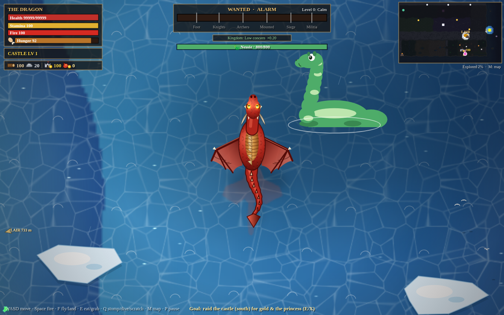 | 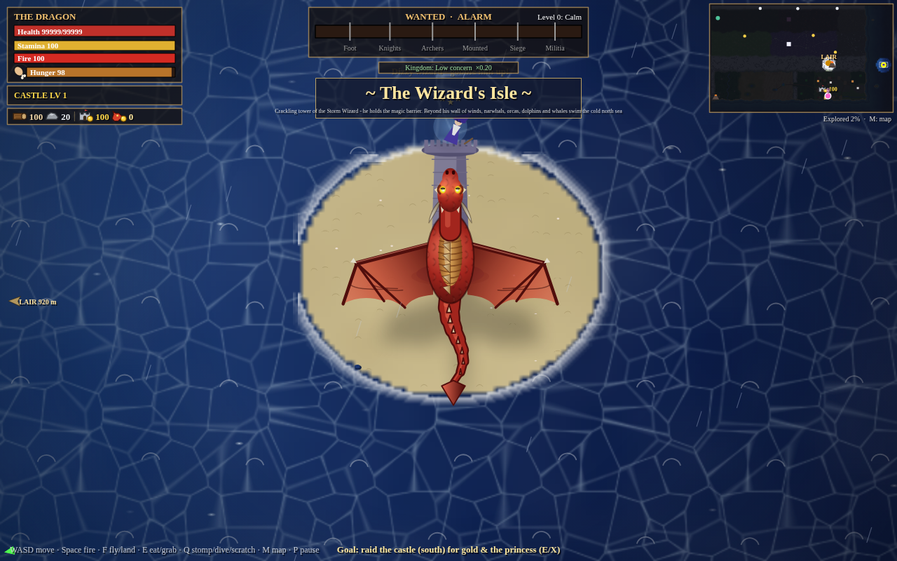 |
| Kraken Deep edge, before | Kraken Deep edge, after |
| 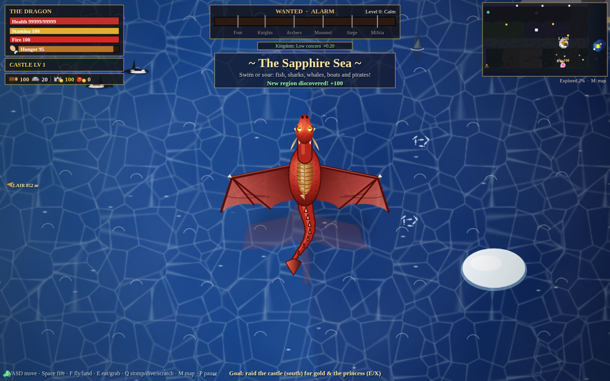 | 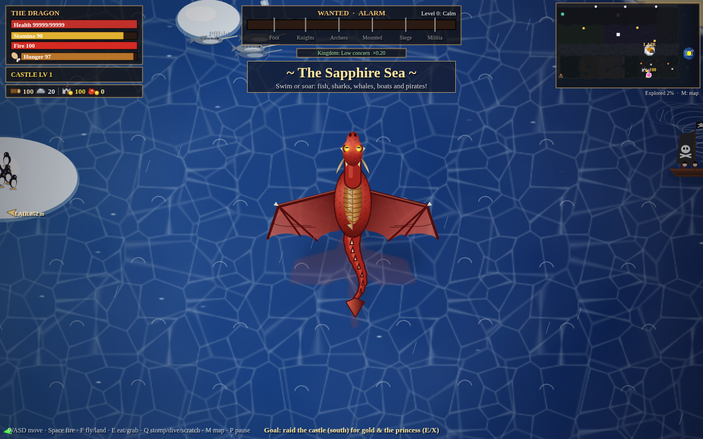 |
| Nessie's loch, before (rings) | Nessie's loch, after (soft) |
| 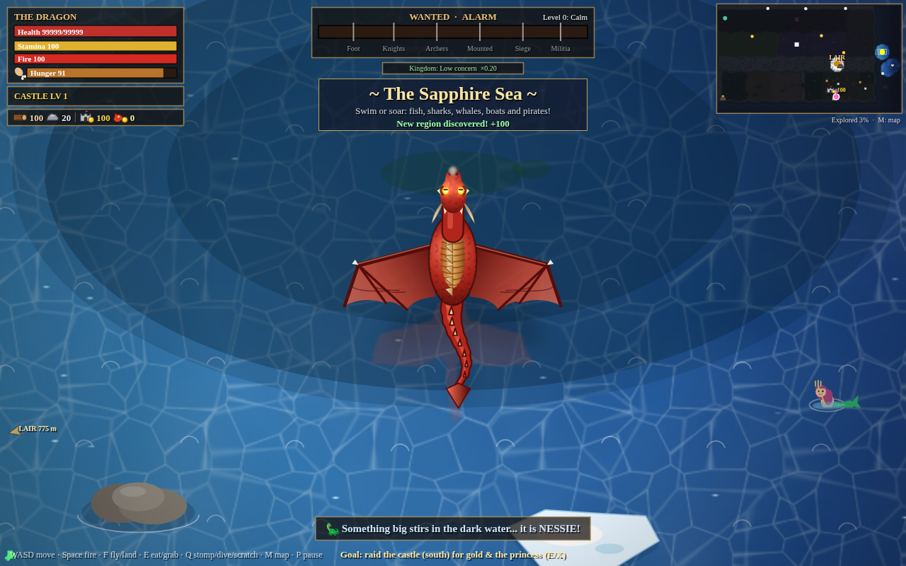 | 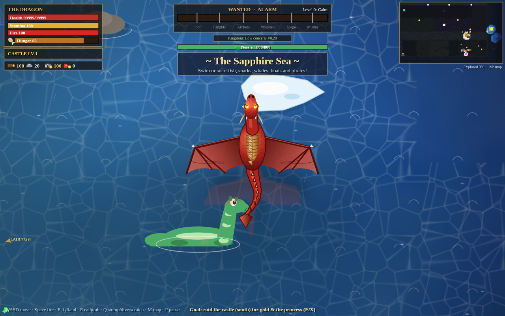 |
| Storm near the isle | Lightning flash |
| 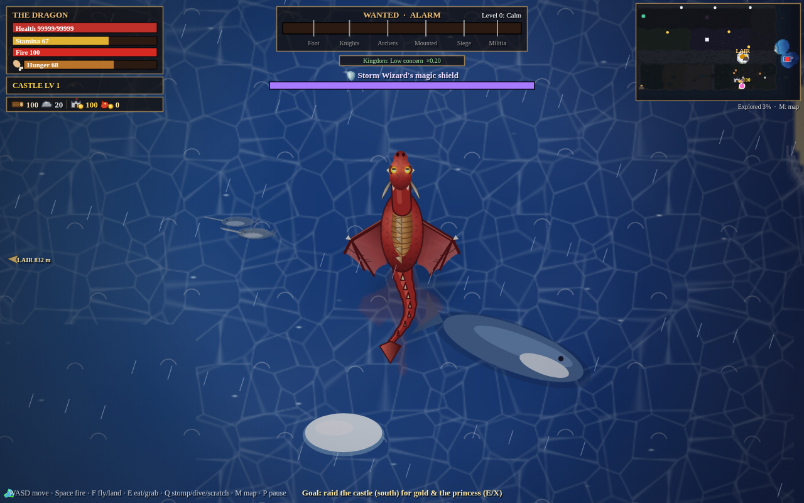 | 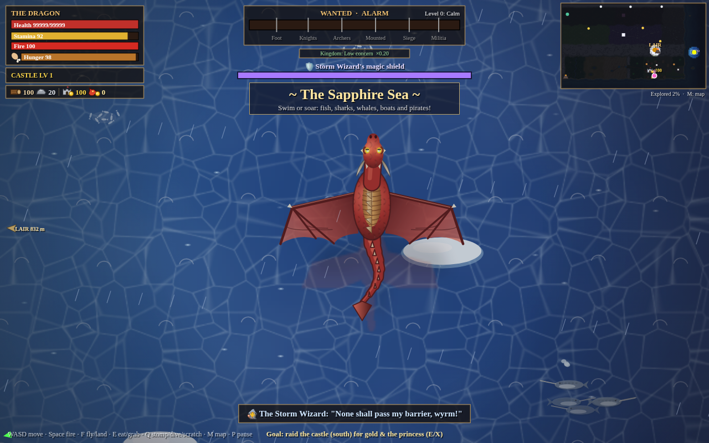 |

## Everyone is on the menu (except three)
Every creature, villager, soldier, animal and mini boss can be eaten once it's worn down or beaten, with a soft white puff and a GULP (no gore). Mini bosses: the Kraken and the giant octopus (dazed), the sand worm (surfaced), the Hydra, the Griffin, the Storm Wizard, the Dark Wizard, Cerberus, Medusa, trolls and cyclopes (dizzy), wild dragons, alphas, princes (under 30%), raid champions (under 50%) and now **Nessie** (beaten). Only three can **never** be eaten: **King William**, **Princess Elizabeth** (she is carried, never harmed) and **your own lair guardian dragons** (they're on your side). A bite at the king just goes *CLANG!*

## The Dark Wizard of Cinder Isle (northern dark ocean)
On **Cinder Isle**, a small ash-grey volcano island in the northern dark ocean (about x 9700, y −9000), the **Dark Wizard** guards his own volcano.
- **Magic shield:** the same rules as the Storm Wizard: every hit (fire, lava, stomp, dive, claw, bite) drains his shield, and his obsidian spire is invulnerable until he is beaten. Shield **525** (1.75× the Storm Wizard's 300); it does **not** grow with the castle level. Easy mode: ×0.7.
- **Spells** (every 2 s, Easy 2.8 s), starting when you come within 1,400 px:
  - **Lava shots:** 5 lava blobs, 13 damage each. These never melt in water.
  - **Eruption:** his volcano erupts in a ring that grows to 900 px over 1.5 s: 6 damage and a strong knockback (stronger than the wind wall's push).
  - **Purple lightning:** a purple mark appears for 1 s, then the bolt hits for 8 damage.
- **Beat him:** your reward is **his volcano and the purple triple lava shot** (below), plus a full heal, the *Volcano Tamer* achievement and a horn. There is no gold or max-health bonus for beating him. He lies dizzy and can be eaten (+40 HP, *Spicy Snack* achievement). His spire can then be smashed for +100 gold.
- **He stays beaten** through every level-up and save/load; he never respawns in that game. Starting a new game (after your dragon is defeated) brings him back, like the Storm Wizard.

## Purple TRIPLE lava (the Dark Wizard's reward)
Beating the Dark Wizard unlocks **his volcano for lava drinking**: land anywhere by the crater on Cinder Isle and press **E** (pad X / touch DRINK). The rules are exactly the same as at Mount Cinder: a full load of 20 shots, an 8-second refill cooldown, and *Already full of lava!* when you are topped up. Before he is beaten, his shield keeps you away. While he lies dizzy on the rim, the first **E** gulps him and after that **E** drinks. The unlock is saved and kept through level-ups; only a new game resets it. and upgrades lava at **every** volcano (Mount Cinder, Mount Ember and Cinder Isle). A small alert announces it: *"🌋 Purple TRIPLE lava shot!"* (*Dark Wizard beaten · his volcano is yours · 3 purple globs, +50% damage each, at every volcano*).
- Each lava press now lobs **3 dark-purple globs** (straight ahead and ±8°) for the cost of **1 lava**.
- Each glob does **+50% damage**: units 30 → 45 (wet units 25 → 37.5), stone buildings 55 → 82.5, wooden buildings 60 → 90, ships 70 → 105, siege engines 70 → 105. Cooling puddles are unchanged (2 per tick).
- The upgrade is saved and kept through every level-up. Like the Dark Wizard's beaten state, it resets only on a new game.

| Volcano fight | Eruption |
|---|---|
| 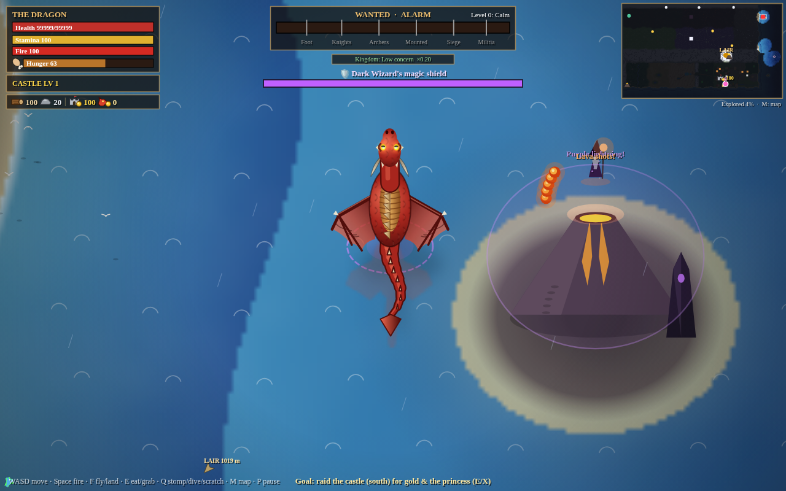 | 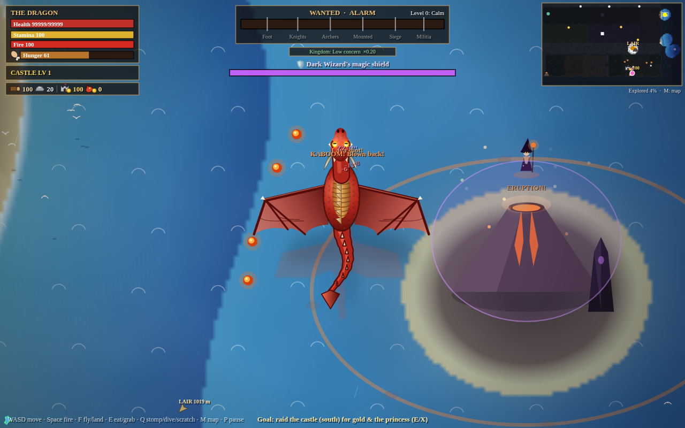 |
| Beaten: triple lava unlocked | Purple triple lava shot |
| 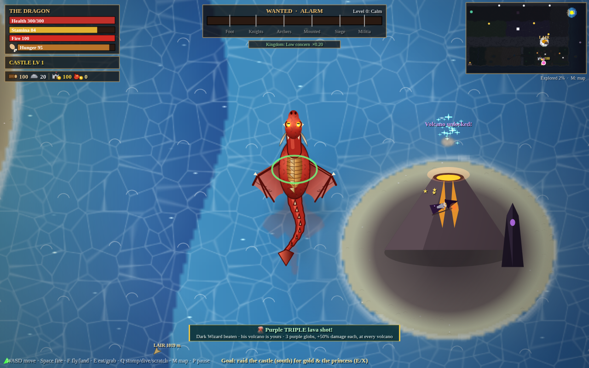 | 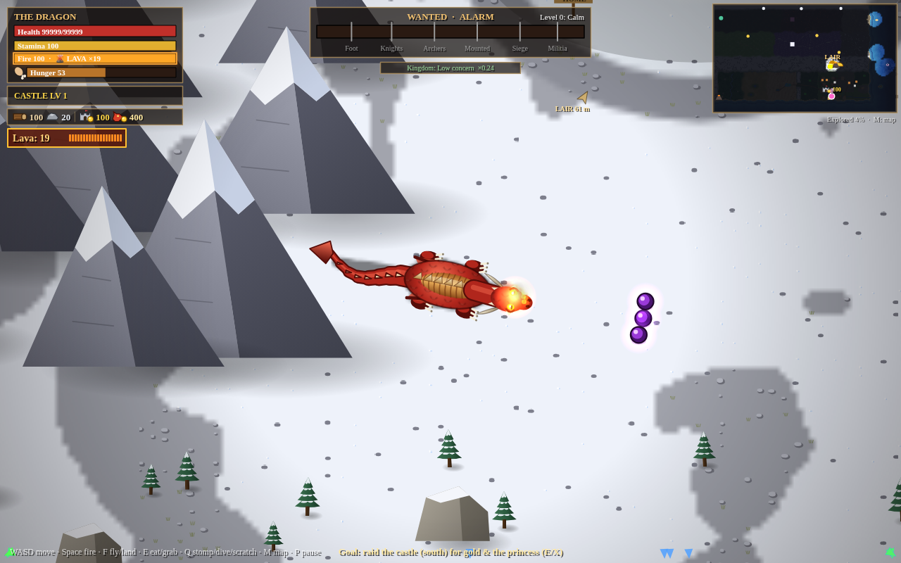 |
| Volcano Tamer achievement hint | Drinking lava at Cinder Isle |
| 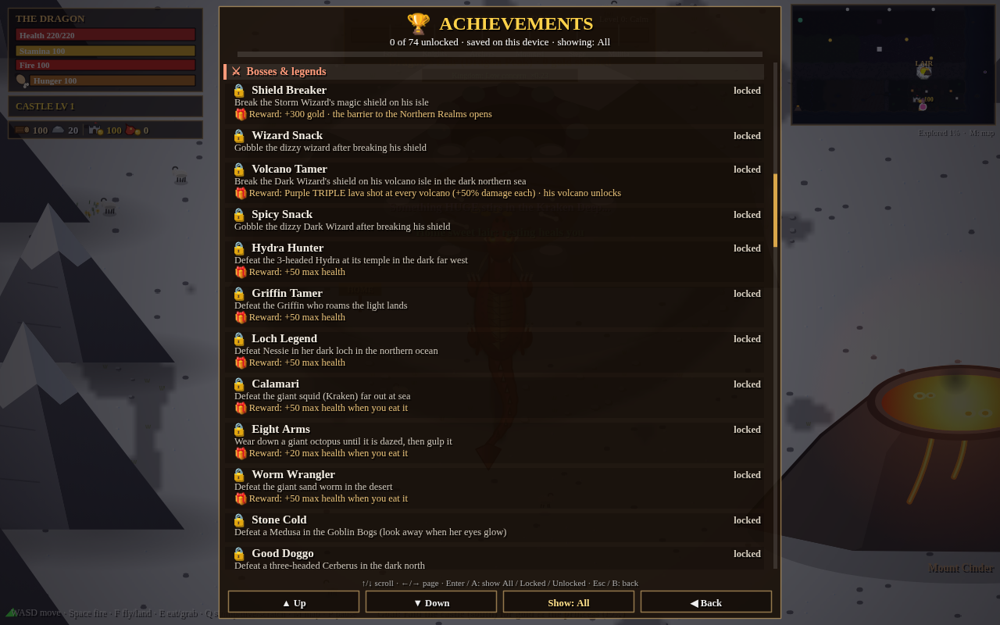 | 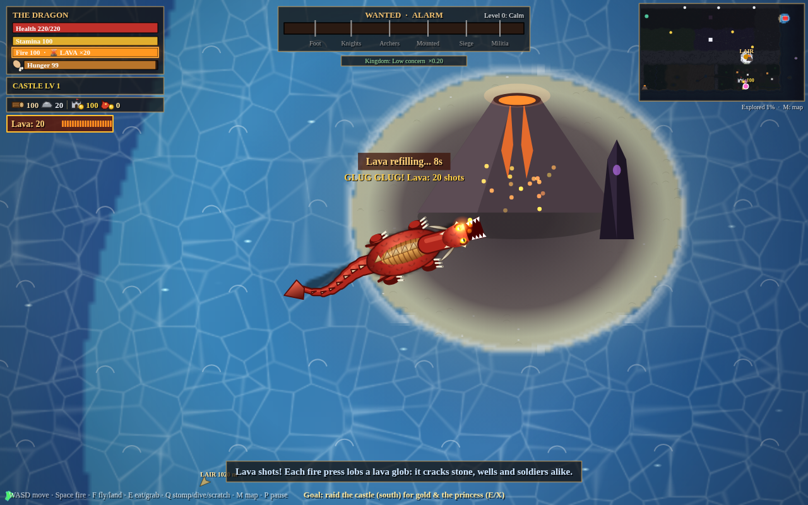 |

## Wanted tiers and the MILITIA
The WANTED meter rises as you cause damage and cools down faster the farther you are from where the trouble was. Wild animals never raise it. The kingdom's response grows in tiers:
**foot soldiers → knights → archers → mounted knights → siege engines → MILITIA.**
Early waves and patrols are only foot soldiers and knights. Difficulty grows slowly, and Easy mode is gentler still.

### The whole kingdom takes up arms!
When the MILITIA tier is reached, bells ring in every town and a banner reads **"The whole kingdom takes up arms!"** A red HUD strip with a swinging bell shows how many are armed. **Every** villager on the map arms up, each with a red armband and their own tool:

| Who | Weapon | Guards |
|---|---|---|
| Villagers | spears (poke, or throw from range) | their own village |
| Lumberjacks | axes (swing or throw) | the logging camp |
| Miners | pickaxes (swing or toss a rock) | the mine |
| Farmers | pitchforks or scythes | their farm |
| Masons | hammers | the castle gate |
| The hunter | his bow and dagger | his cabin |
| Bucket villagers | throw water and buckets | the fire line (they keep fighting fires) |
| Tax collectors | clubs | their route |
| Caravan / cart drivers | staffs and whips | their cart (carts keep rolling) |
| The lighthouse keeper | an oar (and pebbles) | the lighthouse |

They **defend their own post only**: they engage the dragon when it comes within about one screen of the post, never chase it more than a short leash away, and walk back when it leaves. Nobody marches across the map. When the WANTED level drops below the militia tier, everyone puts their tools down and goes back to work. The armed state is kept in saves. It's all cartoon fun: a dragon can still gulp a militiaman whole.

### Who fights back, and how hard
- **The militia (spear villagers) are the weakest fighters in the kingdom.** They never run away once the Militia tier starts. They close in and poke for **0.5 damage about every 2.2 s**, and now and then throw a spear for **0.4** (about every 6 s). A crowd doesn't make them hit harder, and each has only **8 HP**, so they're easy to beat.
- The militia arm up as soon as the WANTED bar reaches **Militia**. There's no longer an extra hidden wave gate, which used to leave villagers fleeing while the HUD already said Militia.
- **Workers fight back even before the Militia tier.** A lumberjack, miner or farmer at their worksite stands up to the dragon instead of fleeing:
  - lumberjack: axe chop, **2.0 every 1.8 s**;
  - miner: pickaxe, **2.2 every 2.0 s**;
  - farmer: pitchfork, **1.8 every 1.6 s**, or scythe, **2.0 every 1.8 s**.
  - When the dragon leaves (or flies too high to reach) they go back to work. Workers have 10 HP, or 14 when armed at the Militia tier.
- **Plain unarmed villagers still run away** until the Militia tier.
- **Soldiers stay far stronger:** a foot soldier hits for 4 every 1.35 s, and knights hit harder still.

## The East March: a second lumber camp and a second mine
The kingdom has grown east. The Sapphire Coast, the sea, the Lonely Lighthouse and the Kraken Deep moved 3,000 px further east (the world is now 30,200 px wide instead of 27,200), and the new land between Saltmere and the coast is **the East March**:

- **The Eastwood Logging Camp** (around x 6250, y 1250): a tent, a sawmill and the *Eastwood log yard*, in a clearing at the south edge of the Eastwood, a big new pine-and-oak forest. 3 lumberjacks fell its trees.
- **The Iron Crags Mine** (around x 7450, y 2300): a mine head, a miner's hut, mine carts and the *Crags stone yard*, in the rocky Iron Crags. 3 miners dig there.
- Both have their own yards, workers and mine carts. Their supply carts haul the wood and stone along new roads through Saltmere to the **Castle Storehouse**. A road runs from Saltmere to each site, and a track joins the two sites.
- Each site has its own **worksite guard squad**, road-patrol stops and **watchtower spots**. Their workers fight back with their tools like the first camp's, and lost workers are replaced by villagers walking in from Saltmere. Predators (wolves, foxes and boars in the Eastwood, and goats in the Crags) roam nearby.
- The minimap, world map (3 new region names), lair arrow and fog all cover the new land.
- **Old saves** made on the smaller map still load. Anything that was on the old coast or at sea, including the dragon and the fog you had explored there, is moved 3,000 px east with the coast. The East March starts unexplored with fresh workers and yards.

## Kingdom life
- **Castle Aldric** sits in the south-central kingdom, well away from your lair on Dragon's Roost. Roads, waves, patrols, raids, tax collectors and the map markers all start from there.
- **Supply carts and the Castle Storehouse:** lumberjacks and miners pile wood and stone in their yards. Horse carts, each led by a driver, haul it along the roads to the storehouse beside the castle. Carts now run about 1.8× as often: a cart sets off with a part load after 12 s instead of 22 s, loads a unit every 0.6 s instead of 1.1 s, drives at 58 instead of 46, each yard runs 3 carts instead of 2, and a wrecked cart comes back after 20 s instead of 35 s. Only delivered cargo pays for rebuilding, so wrecking a cart costs the kingdom its load.
- **Worker respawn:** when the logging camp, mine or hunters' cabin is rebuilt, new workers walk in from the nearest village.
- **Three hunters per cabin:** the hunters' cabin houses three hunters with bows and daggers. Each one respawns on his own timer (about 20 s, staggered) while the cabin stands. If the cabin is wrecked, none return until it is rebuilt; then villagers walk in one by one and take up the bow until there are three again. To keep it fair they fan out to different sides, only one arrow flies every 0.6 s across the trio, and only one hunter stabs with his dagger at a time. During the militia all three guard their own corner of the cabin. Save and load keep which hunters are alive and their health.
- **Three hunters' cabins:** one in the north of the Deepwood (the original, beside its track), one deep in the **south Deepwood** (around x −2300, y 3300) and one in the heart of the **Eastwood** (around x 7600, y 300). They are far apart, off the roads and away from villages and worksites. Each cabin has its own three hunters with exactly the rules above: their own respawn timers, no respawns while that cabin is wrecked, villagers walking in one by one after a rebuild, militia bows and corner posts at their own cabin, and save/load. Every cabin shows on the minimap and world map (grey when burned). Saves from before the extra cabins load fine and the two new trios simply appear.
- **Roads** link every village, the castle and the camps. They never cross water except over bridges. Patrols and caravans travel along them.
- **Wells** stand in villages. They are tough (about 3× a hut's health) and fire barely hurts them. Small villages always keep at least one well.
- **Town fountains:** the nicer, bigger towns (8+ huts or a market) have a decorative stone **fountain** in the town square, with tiered bowls and splashing water, plus at most one well. Fountains are fireproof and tougher than wells (540 hp, 2× a well). Wreck one and it topples into rubble (counted in the tally as *Town fountain*); villagers rebuild it with stone.
- **Bucket brigades use ANY water:** villagers fetch firefighting water from wells, fountains, rivers, ponds, the lake or the sea shore, whichever is nearest the fire. They walk to the dry bank, fill up (*"A bucket from the river!"*) and run back to throw it.
- **Everything is destructible:** huts, barns, markets, wells, the castle and bridges. Villagers repair and rebuild over time. Buildings and markets drop gold, and the castle collects taxes.
- **Wildflowers** carpet each region in its own colours: meadow, forest, hill, alpine (low slopes only), desert and oasis blooms, and coastal pinks. Villages and the castle grounds have fenced **vegetable and flower gardens**. Fire scorches flowers and gardens to black. Flowers regrow, and villagers replant gardens (the alarm rises a little when a garden burns).
- **Plants burn everywhere:** dragon fire and lava shots set alight savanna grass and acacias, jungle trees (with their vines) and giant ferns, desert cacti and scrub, beach and oasis palms, mountain pines, island grass and the heather of the Dragon Peaks, as well as forest trees, wildflowers and gardens. Burning plants spread fire to nearby plants, flowers, trees and (big ones) buildings, burn down to charred stumps, and later regrow as saplings, just like forest trees. Reeds and other water plants never burn. Burnt plants are saved and loaded.

## The volcano and LAVA SHOTS
**Mount Cinder** smokes and glows just south-east of your lair on Dragon Peak (a volcano marker shows on the minimap and world map). Every 10–18 s it puffs out a harmless shower of embers. Land beside the crater and press **E / X / BITE** (the touch button reads **DRINK**) to gulp **20 LAVA SHOTS**. They replace fire breath until they run out:
- Each fire press (Space, A/RT or the touch **FIRE** button, which reads **LAVA n**) lobs one lava glob. Holding it repeats about twice a second.
- The glob is a short, heavy lob: it lands about **290 px** from the dragon (≈185 px past the mouth, about 62% of the old ~400 px) and splashes over a **130 px** radius (was 80 px, about 1.6×). It sets wood, trees, fields and carts ablaze, hurts and burns soldiers, and, unlike fire, **cracks stone walls, towers and wells**.
- It leaves a **glowing lava puddle** (62–74 px across the middle) that cools over **5.5 s**: bright orange and glowing at first, then deep red, then a dark cracked crust. While it is still hot (about the first 4.8 s) it does a small **8 damage per second** to soldiers, animals and anyone else standing in it (no extra burning) and slowly damages wooden buildings it touches. Once it crusts over it is harmless, then fades. At most **24** puddles glow at once (the oldest cools away first). Over water it fizzles into steam (ships still catch fire).
- The puddles **never hurt the dragon or Princess Elizabeth**. They *can* hurt **King William**: in his golden armour he takes the usual ×0.55 fire damage, and even out of armour he hops and shouts *"Hot! Hot! HOT!"*. As always he can never drop below 12% health.
- While you carry lava, your mouth glows and drips embers, and the HUD shows **Lava: N**.
- At 0 you are back to normal fire. You can refill at the crater 8 s after your last drink.

## The castle gate
The gate is its own destructible part of the castle; fire or stomps bring it down. While it lies in rubble (or is still being rebuilt):
- Waves come about **2.5× less often** and are **half the size**.
- The soldiers trickle out through the rubble one at a time.
- The HUD shows **"Gate destroyed: waves delayed"** with the rebuild status.

The engineers wait about 20 s for the dust to settle, then spend 6 wood and 6 stone from the kingdom's stockpiles and rebuild the gate slowly (about 45 s). When it is repaired, the normal wave pace returns.

## The gold hoard
The HUD shows gold as icons next to the wood and stone: a **castle + coin** with the amount is the gold still in Castle Aldric, and a **dragon + coin** with the amount is your lair hoard. All four resources (wood, stone, kingdom gold, lair hoard) sit on the **left side**, in one compact row directly under the **CASTLE LV** panel (two rows only if the numbers get too wide). The **minimap** sits in the **top-right corner** (inside the iPhone safe area / notch), with its "Explored % · M: map" caption underneath; it shrinks a little on narrower screens so it never touches the centred WANTED panel or boss/raid bars. Announcement banners move below the left column on desktop, or start right of it on touch screens, and stay under the minimap; the lair arrow, hunter arrows and MAP / PAUSE buttons keep clear of both. The pause menu shows the same icons.
The HUD's castle panel shows only the **castle level**. There is no Princess Elizabeth status line, no lair-hoard points line and no blinking *break the stone roof* label over the keep. The wanted/alarm bar stays, and your score is in the pause menu.


**No carrying:** every bit of gold you collect (castle gold piles, coins from buildings, tax sacks, caravans, pirate loot, seashells and so on) goes **straight into the lair hoard** the moment you grab it. A little coin and **+N** pops up next to the dragon icon on the HUD. Raids, raid cooldowns, the ransom and save/load all work from that hoard total.

The gold lands on a visible treasure pile inside the lair, and the pile grows smoothly as your total rises:

| Gold stashed | Stage |
|---|---|
| 0–24 | A few coins |
| 25–79 | Small pile (plus a few coin stacks) |
| 80–199 | Big mound (plus a treasure chest) |
| 200+ | Mountain of treasure: crowns, goblets and gems |

When gold comes in, coins rain into the pile with a clink, and the pile bumps up. On High graphics the hoard glows and twinkles. A label under the pile shows its stage and total. The world map (M) shows a gold mound beside the lair, sized to the hoard, with its total.

## Princess Elizabeth

She is held inside the great keep under a tough **stone roof**. Fire barely scorches it; bites, stomps, the crash stomp and lava shots crack it in stages until it crumbles, and masons patch it while she is inside. The princess has a name: **Princess Elizabeth**. A pink name tag floats above her in her tower, in your claws and in your lair. Messages use her name, such as *"You captured Princess Elizabeth!"*, and the HUD shows where she is. While you carry her, the nearest knights and archers shout rescue calls ("Rescue Princess Elizabeth!", "Unhand Princess Elizabeth, foul beast!"). She is only ever captured, never eaten or hurt, just very cross.

## Hoard raids

A hoard attracts trouble. Raids come on a clock, not on gold growth: **5 minutes after a raid ends** (7 minutes in Easy mode) the next **named knight** comes for the pile, even if it hasn't grown at all, as long as the hoard holds at least **100 gold** (140 in Easy mode). With less than that, no raid comes; the next one is announced as soon as the hoard reaches the minimum. The first raid of a game can't come in the first 30 seconds. The raid's **tier** (champion strength, spears, archers and the share he can steal) is set by the gold in the hoard when it is announced: Tier 1 from 100 gold, 2 from 250, 3 from 500, 4 from 1000, then +1 per extra 1000. The HUD shows the time until the next raid.

**No raids during the King William fight:** from the moment King William runs to the armoury to suit up, through the armoured fight, his shelter in the keep, second wind, dizzy spell and any charge or princess-rescue chase, no new hoard raid is announced (the HUD says *"No hoard raids while King William is fighting"*). A raid that was already announced or marching before he went to suit up carries on as normal. When he is calm again the usual raid rules resume after a 20-second grace, and only one raid comes, never a backlog.

1. **Warning:** a banner reads, for example, *"Sir Gareth the Bold vows before King William to claim the dragon's hoard!"* A horn sounds, and you get **8 seconds** to get ready.
2. **March:** the champion rides out of the castle gate with an escort of foot soldiers. The escort carries heraldic flags and spears with pennants in the champion's colours. The party goes east along King William's road, then up the mountain trail to Dragon Peak, which takes about 45 seconds.
3. **The champion** is a mini-boss. They are bigger, with a plume, a coloured tabard and a crested kite shield, and have a name tag and health bar overhead. Fire does only 60% damage to them. They can't be swallowed until they're below half health; they raise their shield.
4. **Theft:** if the champion reaches the hoard, they grab a share of it that grows with the raid tier (see below; never the whole pile) and carry the sacks back to the castle. Loaded raiders walk home **slower**: the more gold they carry, the slower they go (about 92% speed with 100 gold, 78% with 300, down to 55% with 600 or more), and you can see the gold sacks bouncing on them (1 to 4 sacks by load). If they get through the gate, that gold is gone.
5. **Victory:** defeat or eat the champion (a cartoon gulp), even on the way back, and the sacks drop: all the stolen gold goes automatically back into the lair pile with a '+N' pop. There is **no lump-sum gold bonus**: the only gold is what each knight was carrying (the stolen sacks, which go straight back to the lair). Each knight also carries its own purse, which it drops on the ground when it falls; see *Raid knights drop gold*. You still get 300 + 150×raid points, and the *Raid defeated!* announcement shows every time, including when your guardians win without you (*"Your guardian dragons beat Sir …!"*).

**Raid tiers (by hoard size):** the thresholds above still decide *when* a knight comes, and the 5-minute cooldown is unchanged. How *tough* the raid is depends on the size of your hoard at the moment the raid is announced: **Tier 1** under 250 gold, **Tier 2** from 250, **Tier 3** from 500, **Tier 4** from 1,000, then one more tier per extra 1,000 (2,000 = Tier 5, 3,000 = Tier 6...). The banner says so: *"Sir Gareth the Bold (Tier 3) rides for your hoard!"*

| Tier | Hoard | Champion HP | Spearmen | Archers | Damage | Gold taken |
|---|---|---|---|---|---|---|
| 1 | 100–249 | 150 | 2 | 0 | ×1.0 | 20% |
| 2 | 250–499 | 210 | 3 | 0 | ×1.1 | 25% |
| 3 | 500–999 | 270 | 4 | 1 | ×1.2 | 30% |
| 4 | 1,000–1,999 | 330 | 5 | 2 | ×1.3 | 35% |
| 5 | 2,000–2,999 | 390 | 5 | 3 | ×1.4 | 40% |
| 6 | 3,000–3,999 | 450 | 5 | 3 | ×1.5 | 45% |
| 7+ | 4,000+ | 480+ | 5 | 3 | ×1.6 (max) | 50% (max) |

Champion HP grows gently with the tier (and a little with the raid number), escorts get a bit tougher, and the party never exceeds 8 units, so iPhones stay smooth. Easy mode gives one fewer spearman and softer HP. A raid always leaves you at least 1 gold.

**Trophy banners:** each champion you defeat or eat leaves their heraldic banner planted around your gold pile, in their colours and with their crest (lion, star, tree, crown, sun, moon, rose or bolt). The banners fill a ring around the hoard (back first, then a wider second ring) and wave in the wind. Walk the dragon close to a banner to see that knight's name. Trophies stay for the whole session, even after a new game, and the world map shows a 🚩 count beside the lair.

Every raid uses a new name from a pool of 16 knights and dames, such as Sir Roland Ironheart and Dame Elara the Brave. Toughness comes from the raid tier (above); champion HP also rises a little with each raid (+15 per raid, up to +60) and with the castle level, and from level 2 the escort has one extra spearman. The whole party is capped at 8.

While a raid is on, a HUD bar shows its status (countdown, distance to your hoard, or distance to the gate when they're running off with your gold). The world map and minimap show the party with a flashing banner marker.

Controls are the usual ones: fire, stomp, and bite/eat (E, pad X, or the BITE button on touch).

## The Ancient Jungle Temple
On the east flank of **Mount Ember**, the jungle volcano in the far west of the Emerald Jungle, stands a stepped stone temple, overgrown with vines, with a gold-glinting shrine on top. It is **fire-proof** and too solid for most attacks: use **bites**, the **Q stomp** or **lava shots**. When it crumbles: KA-BOOM, stone blocks fly, and **+100 gold** goes straight to your lair. It is never rebuilt, but a new one stands every level. It has its own Tally line, and a world-map marker once you have seen it.
- **Ember power (once per game):** the first time you wreck the temple you also get a **permanent +10 max fire** on top of the 100 gold, shown in the small alert at the bottom of the screen (*"🔥 Max fire +10!"*). It stacks with the nest-egg fire boosts, carries over every castle level and is kept in saves. Wrecking the temple again on later levels still gives the 100 gold, but no more fire. A new game resets it.

## Mount Ember (the second volcano)
A second volcano, **Mount Ember**, smokes in the far south-west of the jungle. You can drink lava there just like at Mount Cinder (lava shots). It erupts now and then, raining embers that can set nearby jungle plants and trees alight and leaving lava puddles. Both volcanoes show on the world map. Trees, decorations and animals never spawn on its cone.

## Town economy and the tax collector
Houses (huts and adobes) slowly earn gold, and merchant shops (stalls, fishmongers, bakeries, smithies and jewellers) earn it 2.5× faster. This gold is **hidden**: nothing on screen shows it. It is **not** the kingdom's gold until the tax collector physically carries it to the castle.
- The tax collector empties each building into his sack, but always leaves **1 gold in a house and 3 in a shop**.
- **Intercept him** and his sack goes straight to your lair pile; it never reaches the castle.
- **Wreck a house or shop** and whatever gold it held drops automatically into your lair pile.
- **Escort:** with a heavy sack (25+ gold) he asks any **patrol he passes within about 200 px** to walk him home: 2 guards at 25 gold, 3 at 40, 4 (the cap) at 60. He never calls patrols from afar, and they never detour; if none is near, he walks alone. The escort walks with him, fights you, and returns to its patrol route after delivery. His sack visibly fills up. Buildings' gold, the tax collector and his escort are all saved.

## The rich desert caravan and Sandhaven's troops
One of Sandhaven's two camel caravans is a **rich caravan**: three colourful camels (striped blankets, tassels and bells), one carrying a **treasure chest**, and two richly dressed traders. It plods along the roads from Sandhaven to the castle gate and back again (about 67% of its old pace: lead trader 38 → 25.5 px/s), resting at each end.
- **Escort:** exactly **10 desert soldiers** (turban, sand robe, scimitar and round shield) and **6 desert archers** (blue turban and a curved bow, which shoot from about 420 px), marching in formation: two files of soldiers flanking the camels, archers at the front, rear and sides.
- **Desert troops are tougher** than the kingdom's regulars: desert soldier 35 HP (regular foot soldier 24), desert archer 32 HP (regular archer 22), and they hit 25% harder (5 instead of 4). HP still grows with the level.
- **Sandhaven garrison:** 3 desert soldiers + 2 desert archers always guard the town, separate from the escort, fresh every level (and saved).
- **The escort defends the caravan:** guards stay on a leash around the camels. When the dragon comes within 300 px of the caravan, the guards turn out and chase it, but never more than 380 px from the lead trader ("Back to the caravan!"); then they regroup into formation. In a test, a dragon landing next to the caravan drew guards at most 368 px away, and they regrouped to 156 px. (Before, guards could be pulled over 1000 px away.)
- **Camel soldiers:** each caravan (the rich one and the ordinary one) has **2 camel riders** (desert soldiers riding camels, with swords) that keep to the caravan under the same leash rules, and **4 camel riders** guard Sandhaven every level. They are saved and have their own *Camel soldiers* Tally line.
- **Predators:** lions, hyenas, big cats, wolves, bears, scorpions, snakes and the like that come near the caravan get chased off by the escort; the animal fights back, and once worn down it simply runs off (nobody is defeated for good). If the dragon attacks, the guards turn on the dragon first.
- **Raid it:** take down the lead trader or the treasure camel and **+20 gold** goes to your lair, whether you catch it on the way to the castle or on the way back after it has paid the king.
- **It pays the king:** every time the rich caravan reaches the castle gate, **+50** goes into the king's treasury.
- **Respawn:** a raided rich caravan comes back from Sandhaven **10 minutes** later, quietly (no announcement). Fresh every level.
- **Reward towers:** each time a caravan that has paid the king gets safely back to Sandhaven, Sandhaven raises a **sandstone tower** (blue and gold pennant) with a desert archer on top, in the desert around the town (never overlapping). Up to **5**. Towers can be burned down; the archer then joins the town guard, and the next caravan home rebuilds a ruined tower first. Towers are saved with the game and belong to the current castle level (a new level or new game starts with none). Tally: *Sandhaven towers*.
- Surviving guards stay on as **Sandhaven's town guard**. When the kingdom musters (militia), desert soldiers and archers guard Sandhaven too.
- Desert soldiers, desert archers and raided rich caravans have their own **Sandhaven** section in the Tally. The caravan and the town guard are saved.

## The desert (Scorching Sands, west)
Sandhaven and its bazaar, an oasis, camel caravans on the road, desert animals, vultures and a **sand worm**. Reach it through the mountain pass. Hunger drains 1.35× faster in the heat. The desert is about 17% narrower than before, so the crossing to the savanna is shorter.

## The Golden Savanna and the Emerald Jungle (far west, past the desert)
The map is 36% wider (27,200 px instead of 20,000). Past the desert crossing, the sand blends into the **Golden Savanna**: golden grass, acacia trees, termite mounds, rocky kopjes and **two watering holes** (the big one in the middle and a smaller one further south-west, about 1,500 px away; animals drink at both, crocodiles lurk in the big one, and firefighters fetch water from either). Further west, the savanna blends into the **Emerald Jungle**: dense canopy trees with vines, giant ferns, the **jungle river** (it runs out to the sea) and overgrown **ruins**. The borders fade smoothly; there are no hard edges.
- **Savanna prey:** zebras, gazelles, wildebeest, giraffes, elephants (a feast: food 70), warthogs, ostriches. **Predators:** lion prides, cheetahs, hyenas and circling vultures.
- **Male lions:** every pride is led by a bigger, maned male lion (54 HP and a 6-point swipe that gives the dragon a small shove, against a lioness's 22 HP and 3). He guards the pride's home turf. When he spots the dragon in or near it, he ROARS (visible rings and a roar sound) and calls the pride: any lioness that is hunting drops her hunt and runs in to fight. Once the dragon has been away from the turf for a few seconds, they calm down and go back to normal. He has his own Tally line ("Male lions").
- **Jungle prey:** monkeys, tapirs, capybaras, frogs, parrots and toucans. **Predators:** jaguars, tigers, pythons, and crocodiles in the jungle river. The jungle has about 5% more animals: 13 monkeys, 7 tapirs, 11 capybaras, 15 frogs and 13 river fish (up from 12, 6, 10, 14 and 12). Predator numbers are unchanged. The ancient ruins are python country: 12 pythons coil around the three ruin sites (5, 4 and 3, biggest ruin first) and 2 more roam the jungle, 14 in all (up from 4). Pythons that are eaten come back at the ruins.
- Every existing rule applies: they hunt, respawn only in their home region, count for the Glutton milestone, never raise the wanted level, and have Tally entries (greyed out until discovered). The regions have their own banners, fog, world-map labels and minimap colours, and are saved and loaded.
- Hunger: 1.1× in the savanna, normal in the jungle. Flying nonstop from the castle you arrive in the savanna hungry, so snack on a lizard or camel in the desert on the way (the test does this and arrives with plenty left).

## The Dragon Peaks (far north-west)
A craggy roost of smaller **wild dragons** with their nests, mountain goats and eagles, plus purple heather (which burns). Wild dragons are never killed outright: worn down to 1 HP they are dazed (cartoon stars) and can be gulped. Hurting one makes it (and, in Normal mode, its roost-mates) defend. A dragonet hatches from a nest about every 100 s while the roost is small. **Eating a wild dragon gives +5 permanent max stamina** (the yellow Stamina bar used for flying, not the fire meter; a *"+5 Stamina!"* popup shows it). It stacks, stays on the same life across castle levels, resets on death or a new game (like the nest-egg fire bonus), and is kept in saves. It no longer gives max health. The giant octopus still gives +20 max health.

## Meerkats, roadrunners, jackals and bulls
- **Meerkats** (savanna and desert) live in colonies at burrow mounds. A lookout squeaks when the dragon or a predator comes near and everyone dives into the burrows, where they can't be bitten, burned or caught.
- **Roadrunners** (desert) zig-zag away at top speed with dust puffs and a "Meep meep!".
- **Jackals** are small scavenger-hunters that chase meerkats and roadrunners.
- **Bulls** (1–2 per cow pen) paw the ground, snort steam, then charge and ram. A damaged fence lets a bull break out, chase you briefly and trot home. Their tough hide means they must be worn down before you can swallow them. Farmers mend the fences.

## Quick dodges
Hunters and nimble animals (deer, gazelles, rabbits, foxes, wolves and the white alpha, jackals, hyenas, big cats, monkeys, meerkats, roadrunners) sometimes see an attack coming and **dash sideways** in a puff of dust ("Dodged!"). It works against fire, lava, stomps, scratches and bites. A dodge only happens if they've had a moment to notice you, it has a few seconds' cooldown, and grabbed, carried or eaten creatures can't dodge. Heavy animals (bears, boars, bulls, elephants, crocodiles and so on) never dodge.

## Exploration carries over
The fog of war you've cleared and the places you've discovered stay revealed when you move up a level, and they're kept in your save. Only a brand-new game starts with a fresh map.

## Predators hunt, and more prey
- Prey populations (spawn counts and respawn caps for wild prey, herds, fish schools and birds) are **5% higher**, rounded per group, so some groups gain one animal and small groups stay the same.
- **Every predator hunts:** wolves, foxes, bears, mountain lions, snakes, desert foxes and scorpions, the sand worm, hawks, eagles, gulls, sharks, the squid, crocodiles, lions, cheetahs, hyenas, jaguars, tigers, pythons and vultures stalk, chase and **gulp** their prey, which vanishes in a cartoon puff of stars or feathers (no gore). Prey that escape run away.
- Performance: only a few predators look for prey each frame (6 on High graphics, 3 on Low), so the hunting costs almost nothing.

## Crocodiles (fresh water only)
Crocodiles live only in **fresh water**: the Silver River, Mirror Lake, the ponds, the big savanna watering hole and the jungle river. They never appear in the sea or the desert oasis. They lurk with only their eyes and snout showing, then lunge at animals that come to drink, fish and birds. They **snap at the dragon** (8 damage) when it swims or walks close by. They are edible (food 22) and wild, so eating them never raises the wanted level. They respawn slowly (at most one every ~75 s), appear in the Tally and are saved and loaded.

## Princess ransom
When you deliver Princess Elizabeth to your lair (a level win), **King William pays a ransom** at the start of the next level: **100 gold + 50 per castle level beyond the first + 10% of the gold still in the castle treasury**. A banner reads *"King William pays a ransom for Princess Elizabeth: +X gold!"* and coins fly into your hoard, on top of the gold you carried over. The ransom counts toward raid thresholds, but a raid can't start in the first 45 seconds of a level.

## Prince boss armies (every 5th castle level)
At castle level 5, 10, 15 and so on, a named **prince** comes for the dragon. A herald announces *"Hear ye! Prince … vows before King William to slay the dragon!"*, then after a horn call and war drums his **royal war fleet** sails in from the southern sea edge: 2 warships at level 5 and one more for each later prince. While at sea, the ships can be burned, hit with lava shots or raked with a claw scratch. Sinking a ship dumps its soldiers into the sea; they can't swim in armour, so they cling to barrels and are fished out (no drowning). The ships that make it beach at the landing spot (⚓ on the map), and from then on **the prince and his whole army hunt the dragon down together as one group**, wherever you are on the map. The prince rides his white warhorse at the head and his soldiers march in formation (rows of four) behind him. About every 1.2 seconds he re-targets your current position. Long distances follow King William's roads, short ones go straight across dry land, and they never wade into water: if you hover over the sea or a lake, they head for the nearest dry ground. His army is **separate from the regular soldier waves**. It doesn't count toward wave reinforcements, and defeating his soldiers doesn't raise the WANTED meter, so regular waves still come only from the WANTED level. The empty ships stay on the beach and can be burned. The prince has a boss health bar (600 HP at level 5, +650 per later prince) and can only be eaten below 30% health. Beating him gives 250 gold (+150 per later prince), 1,500 points per prince level and his royal banner as a trophy. There are no hoard raids during a prince attack.

**Prince tiers.** The first prince (level 5) is a gentle warm-up, and each later prince (levels 10, 15, 20 …) is a clear step harder:

| Prince (castle level) | Health | Lance thrust | Charge | Cavalry charge | Army |
|---|---|---|---|---|---|
| 1st (5) | 600 | 8 | 8 | 8 | 6 |
| 2nd (10) | 1,250 | 14 | 11 | 10 | 12 |
| 3rd (15) | 1,900 | 20 | 14 | 12 | 18 |
| each later | +650 | +6 | +3 | +2 | +6 (max 40) |

His soldiers get tougher per tier too (foot 26 HP +6, knights 48 +8, archers 20 +4, cavalry 85 +10). Easy mode gives the prince 25% less health and 2 fewer soldiers.

## King William's trade ships
When something is wrecked and the stockpile can't cover the rebuild, **King William orders a shipload of wood and/or stone worth 25% of the castle treasury** (at 4 gold per wood, 6 per stone; split evenly by value when both are needed, and only the goods the rebuild needs). The shipload always covers at least the shortfall and is worth at least 40 gold; if 25% isn't enough for that he still buys the shortfall, if the treasury can cover it. He never buys for watchtowers, and never twice at once.
- *Before:* each ship brought exactly the shortfall, e.g. 6 wood + 6 stone (60 gold) for a wrecked gate with an empty storehouse. *Now:* with 1,400 gold in the treasury the same gate gets a 348-gold shipload of 42 wood + 30 stone; with 2,400 gold, 73 wood + 51 stone (598 gold). (Briefly, item 90 had ships carry 2.5× the shortfall; item 91 replaced that with the treasury rule before release.)
- **Bigger shipments get bigger escorts** (by the shipload's gold value). The banner names the tier and escort:

| Tier | Shipload value | Trade ship HP | Escort per cart | Escort warships |
|---|---|---|---|---|
| Small | under 100 gold | 130 | 3 foot guards (2 each when there are two carts) | none |
| Medium | 100–249 | 180 | 4 guards + 1 archer (3 + 1 with two carts) | none |
| Large | 250–499 | 240 | 5 guards + 2 archers (4 + 2) | 1 |
| Grand | 500+ | 320 | 6 guards + 3 archers (5 + 3) | 2 |

- **Royal escort warships** (green sails, 200 HP) keep station beside the trade ship; their deck archers loose arrows at a dragon within range. Once the cargo is ashore (or sunk) they sail home. Sinking one doesn't spill the cargo. It's tallied as *Royal escort warships*. Cart archers stand off and shoot when the dragon comes near.

| Grand shipment with 2 escort warships | Grand shipment's carts and guards at the quay |
|---|---|
| 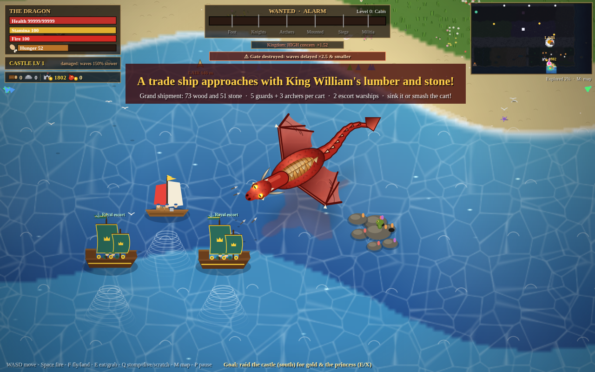 | 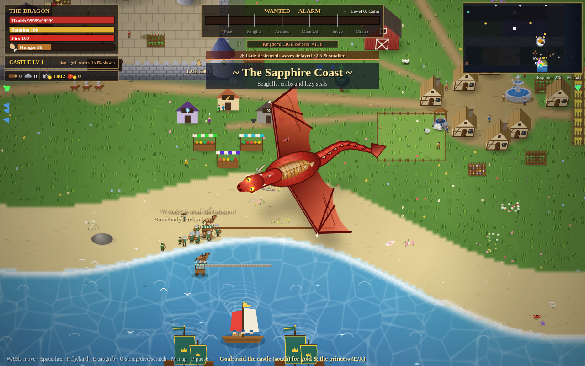 |
- A banner announces *"A trade ship approaches with King William's lumber/stone!"*, a horn sounds, and a gold map marker follows the ship. The banner and horn only play while the dragon is south of the northern fantasy lands; up north the ship still sails, silently.
- The ship sails in from the south edge of the map to the **King's Quay** (a royal dock on the shore below the castle), unloads, and sails home.
- At the quay the goods go onto a **cart escorted by soldiers** (see the tiers above) that drives to the castle storehouse.
- **Sink the ship or smash the cart** and the goods are lost (tallied as *Royal trade ship* / *Royal trade cart*). After a cooldown the king re-buys only if the rebuild still needs it and the treasury can afford it.
- Ships, carts, guards and archers in transit are saved and restored, with their tier. Escort warships are re-launched beside a loaded ship.

## King William
Castle Aldric belongs to **King William**. He stands in the castle courtyard with a gold name tag, and when the dragon comes close he shouts orders, starting with *King William: "Guards! Protect Princess Elizabeth!"*. While you carry the princess away, he calls for her rescue. He can't be eaten or hurt. His name is used in the raid and prince announcements (*"… vows before King William to claim the dragon's hoard!"*), the ransom banner, the prince's march, the tax collectors (*"King William's taxes! Begone!"*), the militia (*"By order of King William!"*) and the castle label.


## King William's golden armour
When the dragon threatens Castle Aldric (comes low within about 520 px of the king, or attacks anything within about 700 px of the castle), King William shouts *"To the armoury!"*, runs into the keep and **suits up for about 3.5 s** (banner: **"King William dons his golden armor!"**, a glow and a *Suiting up!* bar at the keep door). He comes out as a **gold-armoured mini-boss** with a crown helm, sword and shield, an HP bar and the label **👑 King William**, and fights beside the guards, staying within 360 px of his courtyard post.

- **Health:** 600 at castle level 1, +100 per level (max 1600). Easy mode ×0.75.
- **Sword:** 10 damage +1.5 per level (max 22) every 1.1 s. Easy mode ×0.7.
- **Shield bash:** 8 + castle level damage every 6 s, which shoves the dragon back 40 px (never through walls). Easy mode ×0.7.
- **Armour:** fire does ×0.55 damage to him, and every other hit ×0.8. A bite does 40 (before armour) and goes *CLANG!*: he can't be eaten.
- **Retreat:** at **30% health**, the banner **"King William retreats to safety!"** appears. He runs into the keep, where Princess Elizabeth is held under the stone roof. Inside he can't be targeted, and a heal bar shows *King William is resting in the keep*.
- **Healing:** 3% of his max health per second while inside.
- **Returning:** he comes back out if the attack is still going **35 s** after he went in and he's at least 90% healed.
- **Calm:** after 30 s with no threat, he takes the armour off and returns to his post.
- **He can never be eaten or killed.** His health can't drop below 12%, and nothing can flag him as dead.
- The armour resets every level. A save made while he's resting in the keep loads with him still resting there.

### Second wind, knocked out dizzy and the king's charge
- **Round 1** is as above: at 30% health he retreats to the keep.
- When he comes back out, a banner announces **"King William's second wind!"**. This time he **doesn't retreat**: he fights until his health hits the 12% floor.
- Then he is **knocked out dizzy for 30 s** (banner **"King William is knocked out dizzy!"**). He sits on the ground swaying, with stars circling his crown and a *Knocked out dizzy: N s* countdown. While dizzy he can't be hurt, bitten, eaten or targeted, and he doesn't fight back.
- When he cools off, if you **haven't reached your lair**, he gets up and **leads a charge after you** (banner **"King William leads the charge!"**). He takes **every surviving knight, archer and soldier still around him** (guards near the castle; tower archers stay on the walls, and patrol squads, raiders, escorts and the prince keep their own jobs). Nobody new is spawned; if nobody is left, he charges **alone**. They follow behind him in a loose formation, carrying a red war banner, and chase you anywhere on the map, well past his usual courtyard leash.
- The charge turns back for the castle when you reach your lair, after about 90 s, or if he gets knocked out dizzy a second time. The guards then return to their posts.
- If you are already at your lair when he wakes up, he just walks home.
- **Princess rescue:** if you grab Princess Elizabeth and fly her out of the castle area while King William is **not** knocked out dizzy, he gathers his soldiers: **6 s** after you leave the castle with her (**7 s** on Easy), a banner reads **"King William rallies his soldiers to rescue the princess!"**. He comes out in his armour (wherever he was) with every surviving knight, archer and soldier near the castle (no new spawns; alone if none are left) and leads the charge after you. Reach your lair and they turn back; delivering her still wins the level and the ransom works as before. If he is knocked out dizzy when you grab her, there's no immediate chase, but he still leads the usual charge when he cools off (unless you've reached the lair).
- All of this resets each level. A save made during the charge loads with the king safely back home and his guards back at their posts.
## Every bite hurts
Your bite **always deals damage**. If the target can be eaten, it is swallowed as before. If it can't be swallowed yet (a bear, elephant or bull at high health, a pack leader or silverback, a wild dragon, a whale, a raid champion, a prince, the sandworm and so on), it still takes bite damage: a jaw-snap ring flashes on it and a red **-N** shows the damage. The bite never takes a tough target below 1 HP, so you wear it down and then swallow it. King William and Princess Elizabeth can't be bitten.

## Kingdom watchtowers
**Starting stock:** the kingdom starts with **100 wood and 20 stone** (it used to be 8 and 4). This applies to every new game **and to every new castle level**, because moving up a level rebuilds the kingdom from scratch. Loading a save restores whatever the kingdom had when you saved. The starting stock doesn't count toward watchtowers: they still need wood and stone *delivered by carts* during the level. It does let the villagers build carts and upgrade bridges to stone sooner.

**Surplus rule (newer):** towers are only paid for from **surplus**. A wooden archer tower needs the castle's wood to be above the wood it would take to rebuild the *whole* kingdom; a stone crossbow (scorpion) tower needs the stone stock to be above the stone it would take to rebuild the whole kingdom *in stone* (whether or not it has turned to stone yet). Only the amount above the reserve is spent. Once the kingdom is at its tower maximum, stone surplus turns standing archer towers into crossbow towers, one at a time. The older rules below still apply on top.

The kingdom builds two kinds of tower, but only after its worker carts have delivered a **big stockpile**. Nothing is built until **36 wood and stone in total** have been delivered to the storehouse during the current level. Undisturbed carts bring about 4–5 a minute, so the first tower goes up around **minute 8**, mid-game. Only cart-delivered material counts, not the starting stock or free resources. Each tower then spends a large cost from that delivered stock. The kingdom builds whichever type it has the materials for, and it picks the scorpion tower first when it can afford one.

- **Wooden archer tower**: 18 wood + 4 stone, about 14 s to build. An archer stands on top. It has medium health (170) and is **burnable**.
- **Stone scorpion tower**: unlocks from **castle level 3** and needs 50 delivered in total. It costs 6 wood + 22 stone and takes about 22 s to build. A ballista on top turns toward the dragon and fires **big, slow bolts** (one about every 4.6 s, range about 720 px, aimed ahead of you) that hit much harder than arrows. It has high health (560) and is **fireproof stone**: fire does nothing, so you need stomps, dive slams, bites, claw rakes or lava shots.

Placement starts beside the roads near the castle and moves outward (spaced about 650 px apart). The kingdom also builds guard posts at the edges of villages and **beside its worker buildings**: the lumber camp, the stone pile and mine, and the farm barns. Hunters' cabins only count when they are inside the kingdom. Towers are only built in the kingdom's own lands (farmlands, castle, south, lake, hills, coast, the East March and the Iron Crags). The maximum is 2 + the castle level.

When a tower is finished, a banner says **"The kingdom builds an Archer Tower!"** or **"The kingdom builds a Scorpion Tower!"**. The pause menu shows `Towers n/max (a archer · b scorpion)`. The tally counts **Archer towers** and **Scorpion towers** separately. A destroyed tower leaves rubble that still counts toward the maximum, and it is rebuilt as the same type once the stock is there again. Towers, with their type, are saved with the game.

## The lair arrow
A gold arrow circles the dragon and points home to the lair, with the distance. It hides while the lair is on screen, glows while you carry the princess (not for gold, which goes home on its own), and stays clear of the HUD panels and touch buttons.

## Music and sound
All sound is generated in code with Web Audio; there are no audio files. **Every region has its own theme**, and themes crossfade over about 2 s as you cross a border:

| Region | Theme |
|---|---|
| Kingdom Farmlands, hills, lake, south | cheerful medieval (a night version after dark) |
| Castle Aldric (and near the gate) | regal fanfare |
| The Deepwood | mysterious |
| Scorching Sands | Arabian-style scale |
| Golden Savanna | drums |
| Emerald Jungle | marimba and percussion |
| Frostpeak Mountains and the Dragon Peaks | epic low horns |
| The sea, coast and islands | airy pads |
| Your lair / the volcano | dark rumble |

**Boss music** (a prince's army, the sandworm once it surfaces) overrides the region theme; the giant squid keeps its eerie theme. Battle drums play only when you have been hit recently with several foes close by, so tower and castle archers don't drown out the region music. The music is quiet, honours mute, and on iPhone it starts on your first tap. Sound effects (fire, chomps, stomps, crashes, splashes, coins, roars, arrows and more) are panned to where they happen and fade with distance. **N** mutes everything.

## Hunger (normal mode only)
- A drumstick meter in the HUD (under Stamina) slowly empties: about 80 s from full to empty on the ground, and about 60 s at the fastest (flying and breathing fire).
- Eating any person, animal or bird refills it; bigger meals refill more (a chicken about 11, a villager 22, a cow 57, a bear 88). Resting at the lair heals you but does **not** feed you.
- Below 25 the meter flashes orange ("Getting hungry…"). At zero you are **Starving!**: the meter pulses red, a warning appears on screen, and you lose 2.5 HP/s until you eat again. Starving to death ends the game.
- Easy mode has no hunger at all (the meter is hidden).
- Hunger drains 1.4× faster while you swim or fly over water (sea, lake or river).
- **At the lair** (anywhere inside the lair area) hunger drains at only **40%** of the normal rate.

## The sea
- East of the coast is a big open sea. Fly over it, or land on any water (sea, Mirror Lake, the Silver River) to **swim**: you move at about half speed, regain stamina more slowly, cannot stomp, and sit half-submerged with ripples. Biting (E) and fire still work.
- **Sea life:** fish schools (a small snack per bite; fire just makes them dive), sharks (circle and nip you for 3; +20 HP), whales (slow; their tail slaps for 4; too big to swallow until worn down below half health; +75 HP).
- **The GIANT SQUID** lurks in **The Kraken Deep** (far east), its lair now about 320 px further south than before but always at least 260 px inside the deep water, so it never comes near the shallows or the beach. It slams a tentacle where you are heading (dodge the red ring, 9 damage) or grabs you (3 HP/s; burn it to break free). Wear it down until it is **DAZED**, then eat it for +150 HP and +1500 points. It returns only after about 4 minutes.
- **Boats:** fishing boats, merchant ships (they flee and carry a little gold) and rowboats on the lake. Burn them, bite their hulls, or dive slam onto them. Sunk crews swim in the water and can be eaten.
- **Pirates:** cartoony skull-and-crossbones ships that circle you and shoot arrows from the archers on deck (2 each, plus a three-arrow volley every few seconds; no cannons), whether you are flying or swimming. They douse fires after a while, so keep burning! A sunk pirate ship leaves pirate swimmers and a floating gold chest (swoop low to collect it, then stash it at your lair).
- **The Lonely Lighthouse:** a rest-stop island just before the Kraken Deep, with a sweeping light beam and a map marker. Landing on it restores stamina fast and slowly heals you. The keeper and fishermen at the dock are edible and come back over time, and seals lounge on the rocks: they flop into the sea when you come near, are worth +24 HP, and respawn. Pirates rarely sail nearby.
- **Ocean and beach creatures:** moray eels lunge from reefs, narwhal pods roam the northern sea, stingrays lie in the shallows (step on one and its tail barb zaps you; it then glides away, and it zaps predators too), anglerfish lure small fish in the deep with a glowing lamp, sea turtles nest on the beach (hatchlings scurry to the sea), pond turtles plop into the lake, penguin colonies waddle on the shore, and a giant octopus (wear it down until it is dazed, then eat it for +20 max HP). Starfish and seashells dot the beaches; swoop low to pick up shells. All of them are cartoony, never raise the wanted level, and have Tally entries.

## Wildlife (spawns and respawns only in its home region; bigger animals heal more)
- **Farmland:** cows, pigs, sheep, chickens, horses (in paddocks), crows
- **Forest (the Deepwood and the Eastwood):** deer, rabbits, boars, foxes, wolves (packs that nip back), bears (fight back harder, big heal)
- **White alpha wolves:** every wolf pack has a bigger, white-furred alpha (40 HP and a 5-point bite with a small shove, against a wolf's 14 HP and 2). Like the male lion, he guards the pack's woods turf: when he spots the dragon he HOWLS (visible rings and a howl sound) and every wolf that is hunting stops and joins the fight. They calm down after the dragon leaves. A pack that loses its leader gets a new one after a while. He has his own Tally line ("White alpha wolves") and is saved and loaded.
- **Lake/river:** ducks, geese, jumping fish, beavers
- **Mountains/cliffs:** mountain goats, eagles, hawks
- **Coast:** seagulls, crabs, seals
- **Hills/mines (and the Iron Crags):** goats
- **Snowy slopes north of the desert:** three herds of mountain goats that hop over rocks, and the mountain lions that hunt them

## The dragon's body
- **FIRE meter:** fire breath has its own red bar. It drains while you breathe fire and refills when you stop. If it runs dry, you have to catch your breath before it works again.
- **Max health grows (Monster feast):** eating the giant squid (kraken) or a sand worm gives **+50 permanent max health** each, plus a full heal and a *"Max health up! (+50)"* banner.
- **Glutton:** everything you eat adds food (about its size): villager 10, knight 18, mounted knight 40, chicken 5, sheep 14, goat 12, mountain goat 15, cow 26, camel 30, bear 40, fish bite 5, shark 20, **whale 75**, sand worm 100, kraken 150, and so on. Each *whale's worth* of food (75) fills a milestone for **+5 permanent max health** (*"A whale's worth eaten! Max health +5"*). The cost scales: the 1st +5 needs 1 whale's worth, the 2nd 2 more, the 3rd 3 more, and it never stops. The pause menu and the Tally show a *"Next +5: 47%"* progress bar.
- Both bonuses stay on the same life across castle levels, reset on death or a new game, and are kept in saves. The health bar grows with max health but is capped on screen, and always shows the number.
- **Claw scratch:** while swimming, the stomp button (Q / Shift, pad B, or touch, which reads SCRATCH) becomes a quick claw swipe that hits boats, sea creatures and the squid.
- **The hoard carries over:** your lair's gold pile and trophy banners stay when you move up a castle level. They reset only on a new game or when the dragon dies.

## Dragon's Tally, pause, save and load
- Press **P** or **Esc** to pause. The pause menu has the **Dragon's Tally**, a bestiary that counts everything you've gobbled or beaten this game and all-time, plus **Save** and **Load**.
- There are three save slots and an **autosave** every 2 minutes, all stored in the browser.

## Mounted knights
- Fast lance cavalry rides out of the castle gate. They charge in a straight line (the lance only hits a grounded dragon) and then wheel around for another pass.
- They are tougher than foot knights. Fire or a stomp dismounts the rider: the horse bolts and a foot knight is left behind.
- Horse and rider can be eaten for a big heal.
- They join waves from the archer tier, in bigger numbers later, and the wave banner lists them.

## Patrols
- Patrols roam the roads between villages, the castle and the camps, independent of the wanted meter. Each has a random mix of foot knights, archers and cavalry, plus a banner carrier.
- Later levels bring bigger, tougher patrols.
- **How many:** the castle keeps a target number of road patrols out: 3 at castle level 1, 4 at level 2, 5 from level 3 on (easy mode: 2 / 3 / 4), plus up to 2 more when the treasury is full. The first patrol rides out about 20 s into a level, more follow every 25 s (easy 40 s) until the target is reached, and a lost patrol is replaced within about 45 s (easy 70 s).
- The only limit is the number of soldiers on the map (170). Animals and villagers don't count, so a busy map full of wildlife still gets its patrols. Wanted-level waves are separate and unchanged.
- They attack if you come close, and attacking them raises the wanted meter.
- **Keeping the roads safe:** a patrol that meets a predator on the road, or sees one bothering a traveller nearby, shouts "Keep the road safe!" and chases it off (the animal fights back, then runs off), then carries on along its route. The dragon always comes first.
- **Worksite patrols:** a small squad (3 foot soldiers + 1 archer, with a banner) loops around each **lumber camp** and each **mine** (the Deepwood camp, the Stone Mine, the Eastwood camp and the Iron Crags mine). They defend against you and against predators, are fresh every level, and a lost squad is replaced about 60 s later. They don't count toward the road patrol cap.

## Bridges
- Wooden bridges carry the roads over the Silver River. Burn one and it collapses into charred posts.
- Ground units, cavalry, patrols and siege engines can't cross a broken bridge. They detour to another bridge, or around the lake if every bridge is out.
- Villagers rebuild bridges in wood first. From level 3, with enough stone, they rebuild or upgrade them in stone. A progress bar shows the build.
- Stone bridges are fireproof but can be wrecked by repeated stomps (about 5) or heavy dive slams (about 4).
- Each wrecked bridge is worth +80.

## Graphics (High / Low)

Pick it in **Settings** (title screen or pause menu): LOW, MEDIUM or HIGH. **G** on the title screen still toggles Low/High. The setting is saved in the browser (`localStorage` keys `dr_gfxq`, `dr_gfx`). High is the default on desktop, Low on a first touch visit. MEDIUM is High at a lower resolution.

**High** ("cartoon realism"). All art is drawn in code, with no image files. Static art is cached in offscreen canvases.
- Dragon: gradient-shaded body with a scale pattern, belly plates, back ridge spikes, veined and scalloped wings, horns, glowing eyes and claws. It casts a soft shadow that shrinks and fades the higher it flies, and a wavy reflection over water.
- Terrain: textured grass tufts, pebbles, path grit, sand ripples and snow sparkle, baked once per 512 px chunk.
- Water: two moving caustic layers, breathing shore foam and sun glints.
- Trees: layered, shaded canopies that sway in the wind, with pines in the deep forest.
- Buildings: 2.5D houses, barns, barracks and cabins with lit and shaded roof slopes, chimney smoke and windows that glow at night. The castle has brick walls, round towers with cone roofs and flags, and glittering gold piles. Buildings lean slightly with the camera, for parallax.
- People have hair, eyes, rosy cheeks, belts and arms. Animals have fur, manes, spots and wool.
- Fire: additive flames, drifting embers, heat shimmer, an orange glow on the ground around fires and tall smoke plumes.
- Day and night: a full cycle every 5 minutes, with dusk tint, night darkness, warm light pools around fires, windows, torches and the lair, and the Lonely Lighthouse's rotating beam. Also a vignette and fire bloom.

**Low** keeps the original flat look. It has no day/night cycle and is the fastest choice for old machines.

## Mini bosses grow with the castle level
The king's castle gets about **+31% gate health per level** (260 + 80 a level). Mini bosses, the two fantasy citadels and your guardian dragons grow about **half as fast**, and they **keep growing at every level with no upper cap**:
- **Health: +15% per castle level** (×1.15 at level 2, ×1.30 at 3, ×1.60 at 5, ×2.05 at 8, ×2.35 at 10, ×2.8 at 13, ×3.85 at 20, ×4.0 at 21).
- **Damage to the dragon: +6% per castle level** (×1.06 at level 2, ×1.12 at 3, ×1.24 at 5, ×1.42 at 8, ×1.54 at 10, ×1.72 at 13, ×2.14 at 20, ×2.2 at 21).
- **Who scales:** the giant squid (Kraken), the giant octopus, the sand worm, Nessie, the Hydra (each of its 3 heads), the Griffin, Cerberus, and every other dragon (wild and rival dragons). The Lumenspire (light) and Doomforge (dark) citadel towers and the realm's other magic ice and lightning towers scale the same way.
- **Level 1 health:** squid 700, octopus 220, sand worm 270, Nessie 800, Hydra head 85, Griffin 420, Cerberus 90, wild dragon 110, ice tower 70, lightning tower 80.
- **Raid balance holds at any level:** raid champions and your guardians both grow ×1.15 health per level, so one guardian still beats raids up to Tier 5 and two guardians up to Tier 8 at high castle levels too (checked at levels 12 and 20).
- **Never scales:** the Storm Wizard (shield 300 at every level, lower on easy).
- **Regular units don't scale:** soldiers, villagers, realm creatures (orcs, elves, trolls and the rest, including pack alphas) keep the same health at every level.

## Small bottom alerts (permanent boosts and the whale alert)
Permanent boosts (max-health feasts such as *"Max health up! (+50)"*, mini-boss rewards, nest-egg fire, wild-dragon stamina, the Glutton *"A whale's worth eaten! Max health +5"* and similar) now show as a **small dark-teal strip with a gold edge near the bottom of the screen** (above the hint line on desktop, left of the FIRE/BITE buttons on phones), instead of the big centre-top announcement. It looks clearly different from event announcements (raids, battles, bosses), which keep the big banner at the top. Gameplay is unchanged: the gluttony, whale and food rules are exactly as before. If a big announcement is on screen where the pill would touch it (some phone-landscape sizes), the pill waits and shows right after, so nothing overlaps in portrait, landscape or Flip layouts.

## Lair guardians
- **Gold is safe while any guardian stands.** Raiders can't take lair gold while at least one guardian is up (not dizzy). With no guardians, or with both dizzy, a raid grabs the gold as before.
- **They meet every raid.** Guardians leave their circle to meet any raid near the lair at every tier, breathe on it and slow it down.
- **Stats (castle level 1, ×1.15 per level, like the raid champion):**
  - 600 health each.
  - Breath of about 30 damage a second.
  - White: ice that hits 60% to raiders within 80 px and slows them for 2.5 s.
  - Black: lightning that chains to 2 more raiders at 65%.
- **Raider gear vs guardians:** bigger raids bring dragon-hunting gear. Their blows on a guardian (never on your dragon) are multiplied by tier:
  - Tiers 1–5: ×1 to ×1.6.
  - Tiers 6–8 (nets and long spears): ×2.8 to ×3.2.
  - Tier 9 and up (the King's dragonslayer kit): ×8.5 and more.
- **After a fight:**
  - A guardian worn to zero is dizzy, not gone.
  - After 4 s of calm it wakes at 30%.
  - Both heal to full in about 8 s.
- **Simulated win rates** (raid alone vs guardians, dragon away; 10 runs per tier):

| Raid tier (lair gold) | 1 guardian | 2 guardians |
|---|---|---|
| 1–5 (100–2,999) | 10/10 win | 10/10 win |
| 6–8 (3,000–5,999) | 0/10 (raid wins) | 10/10 win |
| 9–12 (6,000+) | 0/10 | 0/10 (raid wins) |

- **Time bought when they lose:** with no guardians a raid reaches the gold about 23 s after it starts marching. When the guardians lose, the grab takes about:
  - 1 guardian: 39–49 s (+16–26 s).
  - 2 guardians: 39–43 s (+16–20 s).

  That is plenty of time to fly home and help.

## Raid gold and map-wide raid alerts
- A beaten raid gives back the gold its knights stole (the stolen sacks), with no lump-sum bonus. Each fallen knight also drops its own purse on the ground (see *Raid knights drop gold*).
- Every raid announcement shows wherever your dragon is on the map, unlike regional news such as the north battle or trade ships, which only show nearby: *rides for your hoard*, *has stolen N gold*, *Raid defeated*, *escaped*.
- A raid announcement keeps the screen for at least 2.6 s. Any other banner that arrives meanwhile shows right after it.

## Raid knights drop gold
- **Every raiding knight carries a purse** and drops it as a gold sack on the ground when it is defeated, whether your dragon or your guardian dragons beat it. Purse size grows with the raid tier: spear knights and archers carry **5 + 5×tier** gold, the champion **20 + 10×tier**:

| Raid tier | Spear knight / archer | Champion |
|---|---|---|
| 1 | 10 | 30 |
| 3 | 20 | 50 |
| 5 | 30 | 70 |
| 8 | 45 | 100 |
| 12 | 65 | 140 |

- **Only your dragon can collect it.** Fly low or land within reach of a sack to add it to your hoard (*"+N raid gold → hoard"*). Guardians don't pick it up, and flying high over a sack doesn't collect it.
- **Uncollected gold is up for grabs.** Knights of a later raid that pass close to a sack on their way scoop it up (*"… scoops up N gold!"*) and carry it on their belt. Defeat that knight and it drops its purse plus everything it scooped up.
- Sacks that land close together merge into one bigger sack, labelled with its amount, and show as gold dots on the map. Knights that escape take their purse with them. The champion's stolen lair gold still goes straight back to the lair as before.
- Sacks on the ground are kept in saves and cleared by a new game.

## Alpha hippos at the watering holes
Each of the two savanna watering holes has its own **alpha hippo**: a big lilac-grey hippo with a little gold crown. It spends its time half-submerged in the middle of the pool, blowing ripples and giving the odd lazy yawn.
- **It guards its pool.** If your dragon comes close **on the ground or flying low** (within about 200 px of the water's edge), it surfaces with a big yawn (*"HRRUMPH! The alpha hippo guards its watering hole!"*) and charges, chomping you for **7 damage every 2 s** (*"Hippo CHOMP!"*).
- **It's a homebody.** It never chases you more than about 300 px from its pool. When you leave or fly high, it grumbles and wades back into the water.
- **Hippos and crocodiles ignore each other.** The crocodile in the pool never hunts the hippo, and the hippo never fights the crocodile; they share the water peacefully.
- **Too big to swallow at first.** While it has more than 60% of its health, a bite just makes it grumpy (*"Too big! Wear the alpha hippo down below 60% first"*) and costs it 10 HP. Wear it down with fire or bites; dizzy stars show when it's ready, and then you can gulp it.
- **Reward:** beating or eating it gives **+250 points**. Eating it is a big meal (**70 food, 50 health**). After about **2 minutes**, once your dragon is well away, a new alpha wades into that pool.

| Stat | Alpha hippo |
|---|---|
| Health | 150 (doesn't grow with the castle level, like other wild animals) |
| Bite | 7 every 2 s (Easy mode lowers it, as with all damage) |
| Charge speed | 88 (wading home: 40) |
| Notices you | within ~200 px of the water, on the ground or flying low |
| Leash | ~300 px from its pool |
| Can be swallowed | below 60% health (90 HP) |
| Reward | +250 points; 70 food / 50 health when eaten |
| Comes back | ~2 min later |


## Achievements
Open **🏆 Achievements** from the title menu (it shows *N of 74* right on the button) or from the pause menu (between *Settings* and *Flip screen*). It's a scrollable list sized for touch: big **▲ Up / ▼ Down** buttons, drag or swipe to scroll, **Show: All / Locked / Unlocked** to filter, and **◀ Back**. On a keyboard: ↑/↓ scroll, ←/→ page, A cycles the filter, Esc/B goes back.
- **Nothing is hidden.** Every locked achievement shows its name and a one-line how-to, so the list doubles as a guide to everything there is to do. Counters show progress (e.g. *260 / 500* gold, *3 / 10* eggs, *1% / 50%* explored).
- **Reward hints.** Anything that gives an in-game reward shows a 🎁 line, even while locked: the bosses' *+50 max health*, the wizard's *+300 gold*, the temple's *+100 gold · +10 max fire (once per game)*, the rich caravan's *+20 gold*, dragon eggs' *+5 max fire*, wild dragons' *+5 max stamina*, the guardian egg hatchlings, trade-ship cooldowns, the hippo's *+250 points*, raid purses, and more. These numbers are read from the game's own settings, so they always match the game.
- **Unlocking** shows a small alert at the bottom of the screen (*"🏆 Name — Achievement unlocked"* plus the reward). If several unlock at once you see two alerts and a *"+N more"* one.
- **Saved on this device** (browser storage key `dr_ach_v1`), separately from save games: unlocks carry across new games, restarts and reloads, and never alert twice.

What's in the list (74):
- **Castle, hoard & princess:** first gold home, 500 / 2000 gold stashed, smashing the keep's roof, grabbing Princess Elizabeth (she is never harmed), flying her home (the ransom), castle levels 3, 5 and 10.
- **Dragons & dragon eggs:** eat your first and 10th wild dragon egg, beat 1 and 5 wild dragons, carry home and hatch the **light (white) egg** from the Lumenspire Citadel and the **dark (black) egg** from the Doomforge Citadel (one achievement each, each hint names the guardian dragon you get), and the Glutton boost (eat a whale's worth of food).
- **Bosses:** the wizard (defeat him, and gobble him), the Dark Wizard (*Volcano Tamer*, with a 🎁 *Purple TRIPLE lava shot at every volcano (+50% damage each) · his volcano unlocks* hint, and *Spicy Snack* for eating him), the hydra, griffin, Nessie, the giant squid, the giant octopus, the sand worm, Medusa, Cerberus, and wrecking the jungle temple.
- **Alpha guardians (first defeat of each type):** the savanna pride's male lion, the Deepwood's white alpha wolf, the jungle's silverback gorilla, the alpha hippo, the white alpha troll and the alpha centaur. **Alphas come back:** a new lion, wolf or silverback takes over about 60 s after you fly away, a new hippo wades in about 2 minutes later, and a new troll or centaur alpha arrives about 75 s later, so you can always find one.
- **Hoard raids & royal fleets:** beat a hoard-raiding champion (1 and 5), pick up a gold sack a raiding knight dropped, stop a prince's royal war fleet, sink a royal warship.
- **Kingdom:** stop a royal **trade ship at sea**, and separately stop a trade ship **on land** (unloading at the quay, or its carts unloading on shore), destroy the **rich desert caravan** (*+20 gold*), break the castle gate, wreck the barracks, topple 3 towers, knock down the lighthouse, wreck a catapult, stop a tax collector, defeat a knight, defeat 50 of King William's soldiers, burn 10 crop fields, knock down or burn 25 trees, and wreck 5 carts.
- **Exploring:** 25%, 50%, 75% and **100%** of the map (the minimap fog), and visiting every region (the list shows which regions you haven't seen yet). All of it is reachable by flying; the far north opens once the wizard's barrier falls.
- **Region feasts:** one per region (Farmlands, Deepwood, lake & rivers, hills & mountains, coast & sea, desert, savanna, jungle) for **eating** at least one of every animal type that lives there. Each shows *eaten / total* and a *"Still to eat: …"* list. Only gulping counts, not burning or knocking out. The princess and the king never count, and alphas have their own achievements instead.
- **First encounters:** one for each other group in the Dragon's Tally (people, the king's army, the desert army, the light and dark lands, boats and siege engines, buildings, and so on).

| | |
|---|---|
| 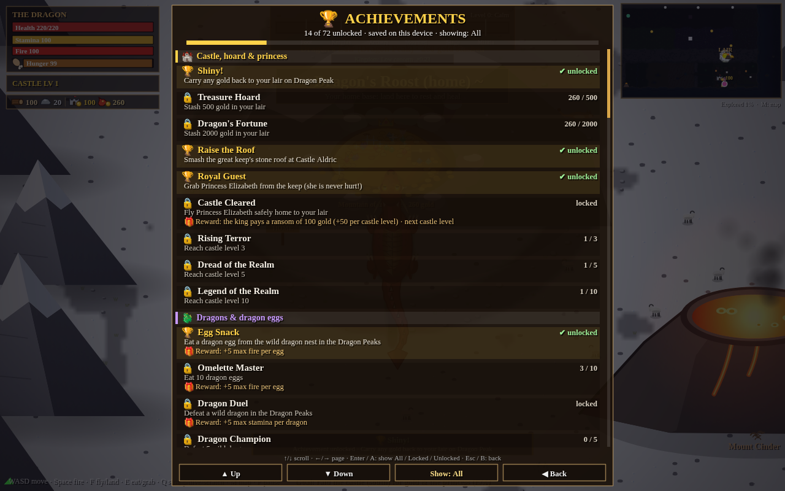 | 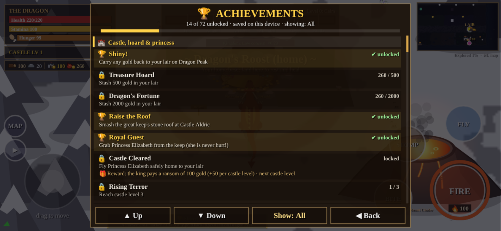 |
| 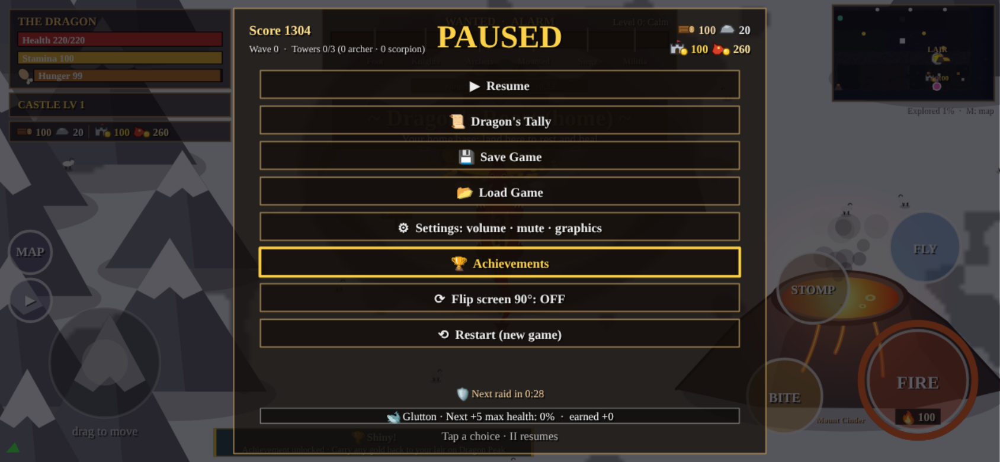 | 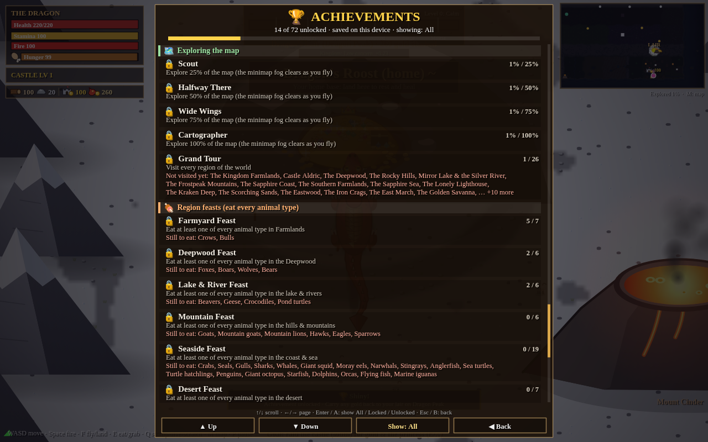 |
| 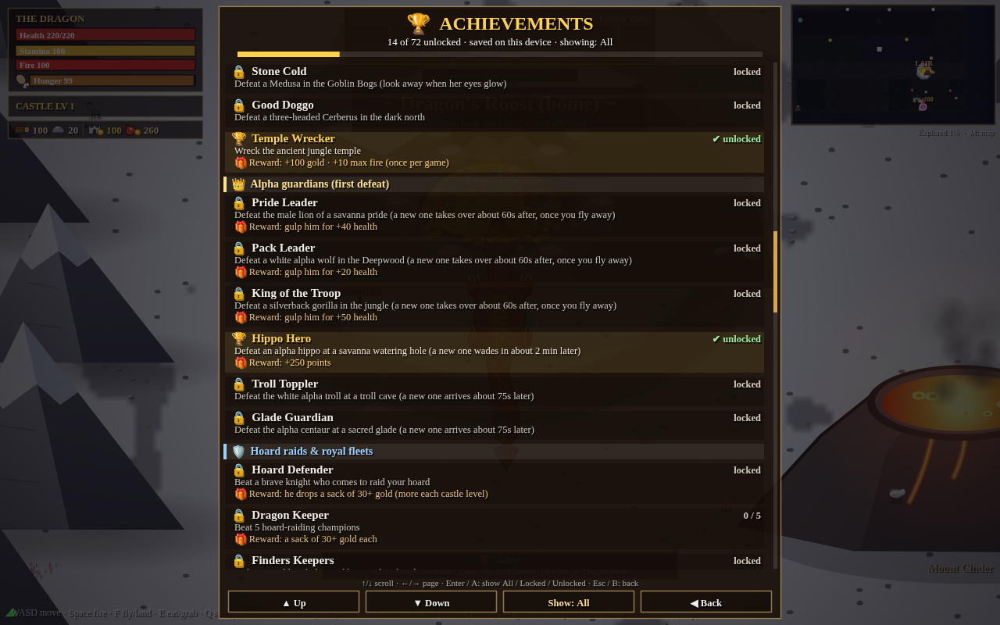 | 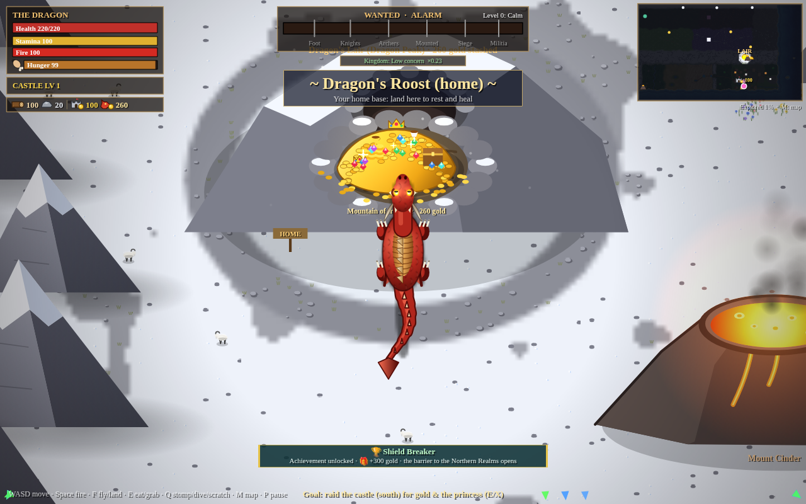 |
